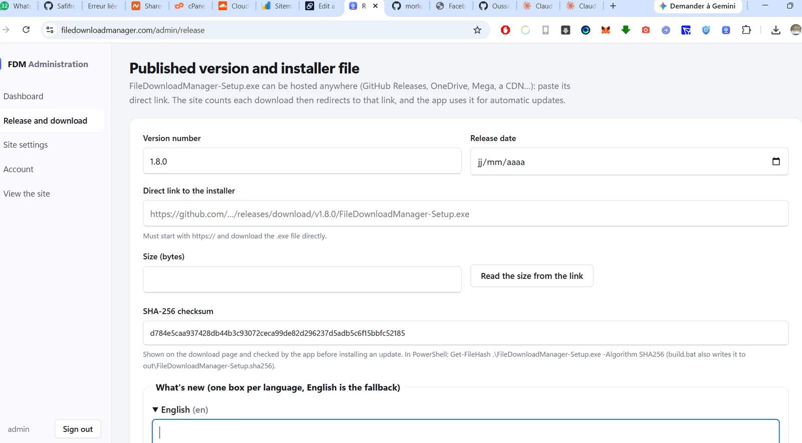
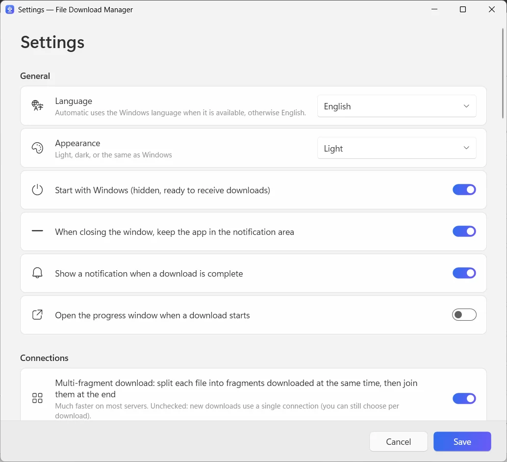

  

<h1 align="center">File Download Manager</h1>

<b>The free download manager for Windows that does it all</b> Free · No ads · Windows 10 & 11

  
  
  

<b>English</b> · <a href="docs/readme/README.fr.md">Français</a> · <a href="docs/readme/README.es.md">Español</a> · <a href="docs/readme/README.it.md">Italiano</a> · <a href="docs/readme/README.ar.md">العربية</a> · <a href="docs/readme/README.ru.md">Русский</a> · <a href="docs/readme/README.zh.md">中文（简体）</a> · <a href="docs/readme/README.hi.md">हिन्दी</a> · <a href="docs/readme/README.ja.md">日本語</a> · <a href="docs/readme/README.ko.md">한국어</a> · <a href="docs/readme/README.de.md">Deutsch</a> · <a href="docs/readme/README.pt.md">Português</a> · <a href="docs/readme/README.he.md">עברית</a>

Speed up downloads with up to 32 connections per file, resume anything that was interrupted, save videos from YouTube and 1,000+ sites in up to 4K or as MP3, and download torrents — in one clean, modern app.

**[Download for Windows](https://filedownloadmanager.com/en/download)** · Free forever. No account, no ads, no bundled software.

## Everything you need to download faster

From a single file to a whole website, File Download Manager handles it — and stays out of your way.

- **Multi-connection acceleration** — Each file is split into up to 32 fragments downloaded at the same time, then joined automatically. Ideal for large ISO images, games and videos.
- **Pause and resume anything** — Lost connection, sleep or restart: the download continues exactly where it stopped, with automatic retries.
- **YouTube and 1,000+ video sites** — Choose the quality — up to 4K at 60 fps — or keep only the sound as MP3. Works with YouTube, Facebook, Vimeo, X, TikTok, Twitch and many more.
- **Torrents and magnet links** — A built-in BitTorrent engine downloads .torrent files and magnet links with DHT and peer exchange. No separate torrent client needed.
- **Works with your browser** — The extension for Chrome, Edge, Firefox, Brave, Opera and Vivaldi catches your downloads and offers to save the video you are watching.
- **Queue and scheduler** — Line up downloads, choose how many run at once, start the queue at night and let the PC sleep or shut down when everything is done.
- **Website grabber** — Save a whole website for offline reading, or collect only the images, PDFs or archives it links to.
- **Video streams to MP4** — HLS streams (m3u8) are downloaded segment by segment and converted into a single MP4 file.
- **Modern and in your language** — A clean Windows 11 interface with dark mode, categories, speed limiter and 13 languages.

## Designed for Windows 11

Fluent design, Mica, light and dark themes: it feels like part of Windows.

| | |
|---|---|
|  |  |
| Simple, clear settings | Light or dark theme |

## Ready in a minute

1. **[Install](https://filedownloadmanager.com/en/download)** — Download the installer and run it. No administrator rights needed; the video and torrent components are included.
2. **[Add the extension](https://filedownloadmanager.com/en/tutorial)** — The app shows you, picture by picture, how to add the extension to your browser.
3. **Download** — Click a download link or the button that appears on a video: File Download Manager takes over and goes faster.

> If Windows shows “Windows protected your PC”, click **More info** then **Run anyway**: the installer is new and not yet known to SmartScreen.

**System requirements:** Windows 10 or 11 (64-bit) · about 500 MB of free space · Internet connection.

## A free alternative to IDM

Looking for an alternative to Internet Download Manager, Free Download Manager, JDownloader or XDM? File Download Manager brings multi-connection downloads, browser capture, video downloads and torrents together — free and without ads.

[Compare the features →](https://filedownloadmanager.com/en/alternative)

## Frequently asked questions

<b>Is File Download Manager really free?</b>

Yes. There is no trial period, no licence key, no ads and no bundled software. The project lives on voluntary donations.

<b>Which versions of Windows are supported?</b>

Windows 10 and Windows 11, 64-bit. The video, MP3 and torrent components are included in the installer, and no administrator rights are needed.

<b>Which browsers work with the extension?</b>

Google Chrome, Microsoft Edge, Mozilla Firefox, Brave, Opera and Vivaldi. The illustrated tutorial shows how to add it in a few clicks.

<b>Can it download YouTube videos and convert them to MP3?</b>

Yes: YouTube and more than 1,000 sites, with the choice of quality (up to 4K when available) or MP3 audio only. Download only content you have the right to download, and respect copyright and the sites' terms of use. DRM-protected services (Netflix, Disney+, Spotify…) are not supported.

<b>Can I resume a download that stopped?</b>

Yes. Pause and resume at any time; after a disconnection or a restart, the download continues where it stopped as long as the server allows it.

<b>Does it download torrents and magnet links?</b>

Yes. Open a .torrent file or paste a magnet link: the built-in BitTorrent engine handles it, with no other software to install.

<b>Is it safe? Why does Windows show a warning?</b>

The installer is new and not yet known to Microsoft SmartScreen, so Windows may show “Windows protected your PC”: click **More info** then **Run anyway**. You can check the file with its SHA-256 checksum on the download page. The app installs for your account only and can be removed from Settings → Apps.

<b>How is it different from IDM?</b>

Internet Download Manager is paid software. File Download Manager is free and also includes video downloads with quality choice, MP3 conversion, torrents and a modern Windows 11 interface in 13 languages.

## Enjoying File Download Manager?

It is free and will stay free. A small donation helps keep it updated. **[Support the project](https://filedownloadmanager.com/en/donate)**

## Links

- Official website: <https://filedownloadmanager.com/en/>
- [Tutorial](https://filedownloadmanager.com/en/tutorial)
- [Privacy](https://filedownloadmanager.com/en/privacy)
- [All versions and SHA-256 checksums: GitHub Releases](https://github.com/Oussama4422/FileDownloadManager/releases)
- [Version history (in French)](docs/CHANGELOG.fr.md)

---

All product names mentioned are trademarks of their respective owners. File Download Manager is not affiliated with them.
