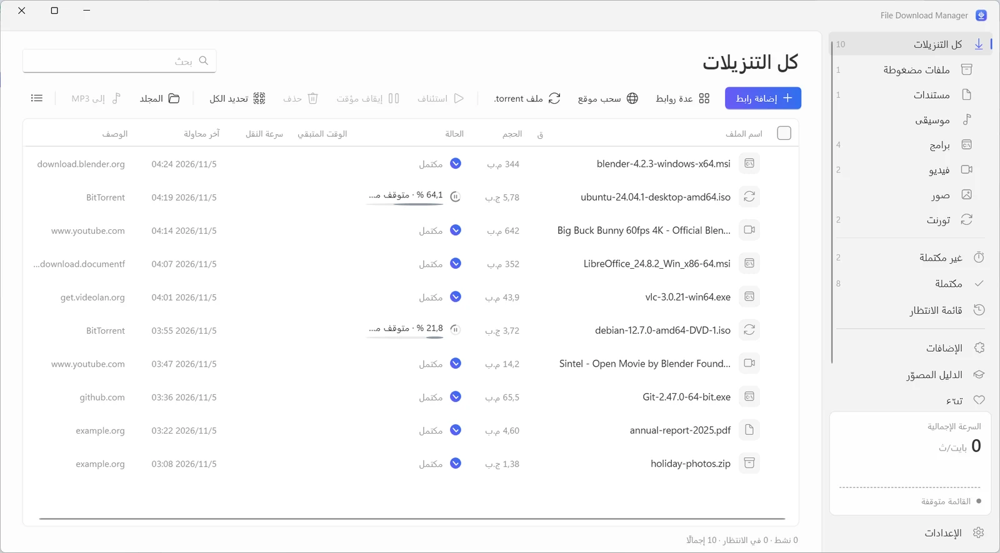
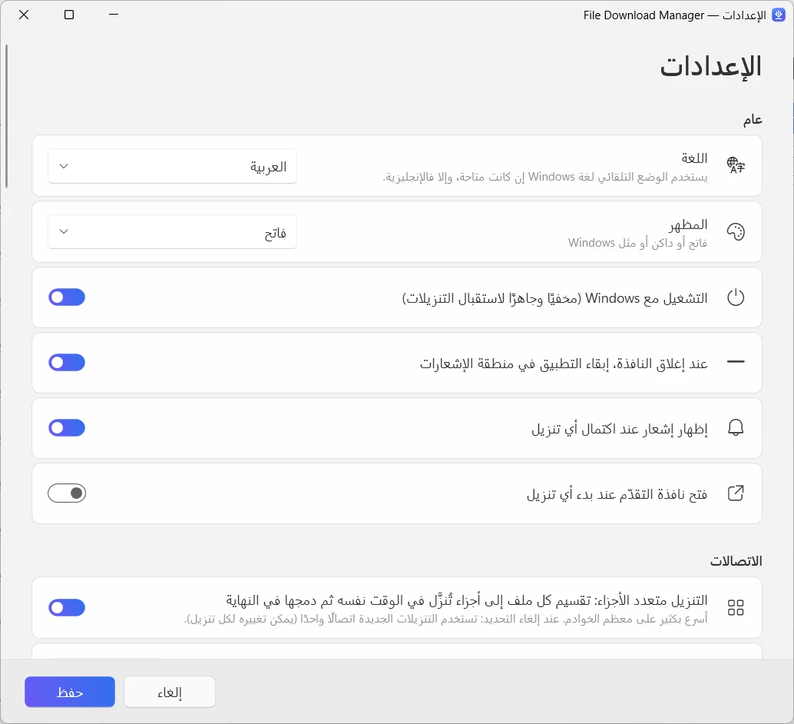

  

<h1 align="center">File Download Manager</h1>

<b>برنامج التحميل المجاني لويندوز الذي يفعل كل شيء</b> مجاني · بلا إعلانات · ويندوز 10 و11

  
  
  

<a href="../../README.md">English</a> · <a href="README.fr.md">Français</a> · <a href="README.es.md">Español</a> · <a href="README.it.md">Italiano</a> · <b>العربية</b> · <a href="README.ru.md">Русский</a> · <a href="README.zh.md">中文（简体）</a> · <a href="README.hi.md">हिन्दी</a> · <a href="README.ja.md">日本語</a> · <a href="README.ko.md">한국어</a> · <a href="README.de.md">Deutsch</a> · <a href="README.pt.md">Português</a> · <a href="README.he.md">עברית</a>

سرّع تحميلاتك بما يصل إلى 32 اتصالًا لكل ملف، واستكمل كل ما انقطع، واحفظ الفيديوهات من يوتيوب وأكثر من 1000 موقع بدقة تصل إلى 4K أو بصيغة MP3، وحمّل ملفات التورنت — كل ذلك في تطبيق واحد أنيق وحديث.

**[تحميل لويندوز](https://filedownloadmanager.com/ar/download)** · مجاني دائمًا. بلا حساب، بلا إعلانات، بلا برامج مرفقة.

## كل ما تحتاجه لتحميل أسرع

من ملف واحد إلى موقع كامل، يتولّى File Download Manager كل شيء دون أن يزعجك.

- **تسريع باتصالات متعددة** — يُقسَّم كل ملف إلى ما يصل إلى 32 جزءًا تُحمَّل في الوقت نفسه ثم تُجمع تلقائيًا. مثالي لصور ISO والألعاب والفيديوهات الكبيرة.
- **إيقاف واستكمال أي تحميل** — انقطاع الاتصال أو السكون أو إعادة التشغيل: يستكمل التحميل من حيث توقف تمامًا، مع إعادة المحاولة تلقائيًا.
- **يوتيوب وأكثر من 1000 موقع فيديو** — اختر الجودة — حتى 4K بمعدل 60 إطارًا — أو احتفظ بالصوت فقط بصيغة MP3. يعمل مع YouTube وFacebook وVimeo وX وTikTok وTwitch وغيرها كثير.
- **التورنت وروابط magnet** — محرّك BitTorrent مدمج يحمّل ملفات ‎.torrent وروابط magnet مع DHT وتبادل النظراء. لا حاجة إلى برنامج تورنت آخر.
- **يعمل مع متصفحك** — الإضافة الخاصة بـ Chrome وEdge وFirefox وBrave وOpera وVivaldi تلتقط تحميلاتك وتعرض حفظ الفيديو الذي تشاهده.
- **قائمة الانتظار والجدولة** — رتّب تحميلاتك، واختر عدد ما يعمل منها في وقت واحد، وابدأ القائمة ليلًا، ودع الحاسوب ينام أو يُطفأ عند الانتهاء.
- **تحميل المواقع** — احفظ موقعًا كاملًا لتصفّحه دون اتصال، أو اجمع فقط الصور أو ملفات PDF أو الملفات المضغوطة المرتبطة به.
- **البث المباشر إلى MP4** — يُحمَّل بث HLS (m3u8) مقطعًا بعد مقطع ثم يُحوَّل إلى ملف MP4 واحد.
- **حديث وبلغتك** — واجهة ويندوز 11 أنيقة مع الوضع الداكن والفئات ومحدِّد السرعة و13 لغة.

## مصمَّم لويندوز 11

تصميم Fluent وتأثير Mica ومظهران فاتح وداكن: يبدو جزءًا من ويندوز.

| | |
|---|---|
|  |  |
| إعدادات بسيطة وواضحة | المظهر الفاتح أو الداكن |

## جاهز خلال دقيقة

1. **[التثبيت](https://filedownloadmanager.com/ar/download)** — حمّل المثبّت وشغّله. لا حاجة إلى صلاحيات المسؤول؛ مكوّنات الفيديو والتورنت مضمّنة.
2. **[إضافة الإضافة](https://filedownloadmanager.com/ar/tutorial)** — يعرض لك التطبيق، صورة بصورة، كيفية إضافة الإضافة إلى متصفحك.
3. **التحميل** — انقر على رابط تحميل أو على الزر الذي يظهر فوق الفيديو: يتولّى File Download Manager الأمر ويحمّل بسرعة أكبر.

> إذا عرض ويندوز رسالة «قام Windows بحماية الكمبيوتر»، فانقر على **مزيد من المعلومات** ثم **التشغيل على أي حال**: المثبّت جديد ولم يتعرّف عليه SmartScreen بعد.

**متطلبات النظام:** ويندوز 10 أو 11 (64 بت) · نحو 500 م.ب من المساحة الحرة · اتصال بالإنترنت.

## بديل مجاني لـ IDM

تبحث عن بديل لـ Internet Download Manager أو Free Download Manager أو JDownloader أو XDM؟ يجمع File Download Manager التحميل باتصالات متعددة والالتقاط من المتصفح والفيديوهات والتورنت — مجانًا وبلا إعلانات.

[قارن الميزات →](https://filedownloadmanager.com/ar/alternative)

## الأسئلة الشائعة

<b>هل File Download Manager مجاني فعلًا؟</b>

نعم. لا فترة تجريبية، ولا مفتاح ترخيص، ولا إعلانات، ولا برامج مرفقة. يعيش المشروع على التبرعات الطوعية.

<b>ما إصدارات ويندوز المدعومة؟</b>

ويندوز 10 وويندوز 11 بنظام 64 بت. مكوّنات الفيديو وMP3 والتورنت مضمّنة في المثبّت، ولا حاجة إلى صلاحيات المسؤول.

<b>ما المتصفحات التي تعمل معها الإضافة؟</b>

Google Chrome وMicrosoft Edge وMozilla Firefox وBrave وOpera وVivaldi. يوضّح الدليل المصوّر طريقة إضافتها بنقرات قليلة.

<b>هل يمكنه تحميل فيديوهات يوتيوب وتحويلها إلى MP3؟</b>

نعم: يوتيوب وأكثر من 1000 موقع، مع اختيار الجودة (حتى 4K عند توفرها) أو الصوت فقط بصيغة MP3. حمّل فقط المحتوى الذي يحق لك تحميله، واحترم حقوق النشر وشروط استخدام المواقع. الخدمات المحمية بـ DRM (Netflix وDisney+ وSpotify…) غير مدعومة.

<b>هل يمكنني استكمال تحميل توقف؟</b>

نعم. أوقف التحميل مؤقتًا واستكمله متى شئت؛ وبعد انقطاع الاتصال أو إعادة التشغيل يستكمل من حيث توقف إذا سمح الخادم بذلك.

<b>هل يحمّل ملفات التورنت وروابط magnet؟</b>

نعم. افتح ملف ‎.torrent أو الصق رابط magnet: يتولّى محرّك BitTorrent المدمج الأمر دون تثبيت أي برنامج آخر.

<b>هل هو آمن؟ ولماذا يعرض ويندوز تحذيرًا؟</b>

المثبّت جديد ولم يتعرّف عليه Microsoft SmartScreen بعد، لذلك قد يعرض ويندوز رسالة «قام Windows بحماية الكمبيوتر»: انقر على **مزيد من المعلومات** ثم **التشغيل على أي حال**. يمكنك التحقق من الملف ببصمة SHA-256 في صفحة التحميل. يُثبَّت التطبيق لحسابك فقط ويمكن إزالته من الإعدادات ← التطبيقات.

<b>ما الفرق بينه وبين IDM؟</b>

Internet Download Manager برنامج مدفوع. أما File Download Manager فمجاني ويضيف تحميل الفيديوهات مع اختيار الجودة، والتحويل إلى MP3، والتورنت، وواجهة ويندوز 11 حديثة بـ13 لغة.

## هل يعجبك File Download Manager؟

إنه مجاني وسيبقى كذلك. تبرّع صغير يساعد على إبقائه محدّثًا. **[ادعم المشروع](https://filedownloadmanager.com/ar/donate)**

## روابط

- الموقع الرسمي: <https://filedownloadmanager.com/ar/>
- [الدليل المصوّر](https://filedownloadmanager.com/ar/tutorial)
- [الخصوصية](https://filedownloadmanager.com/ar/privacy)
- [جميع الإصدارات وبصمات SHA-256: ‏GitHub Releases](https://github.com/Oussama4422/FileDownloadManager/releases)
- [سجل الإصدارات (بالفرنسية)](../../docs/CHANGELOG.fr.md)

---

أسماء المنتجات المذكورة علامات تجارية لأصحابها. File Download Manager غير تابع لهم.

