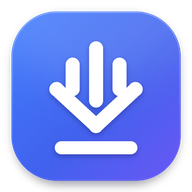
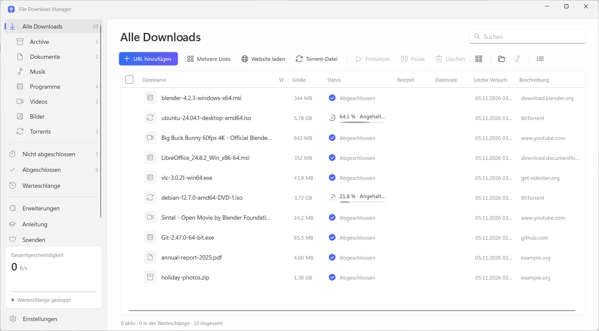
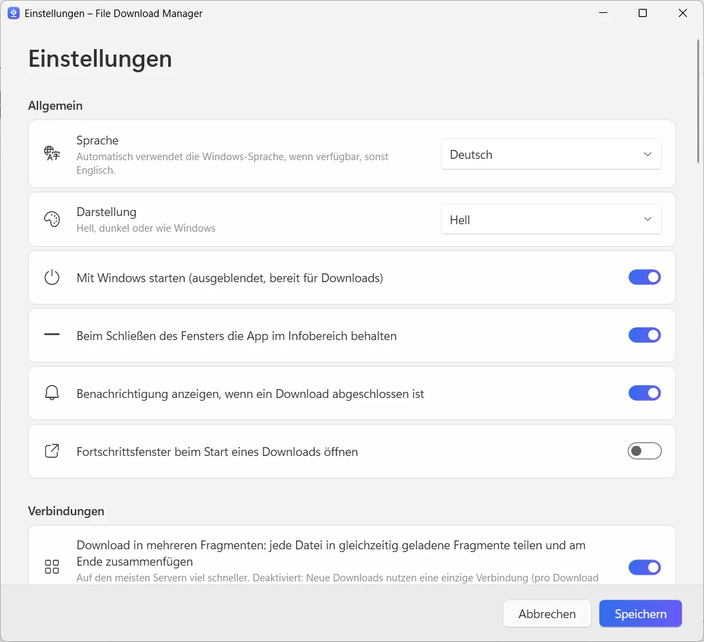
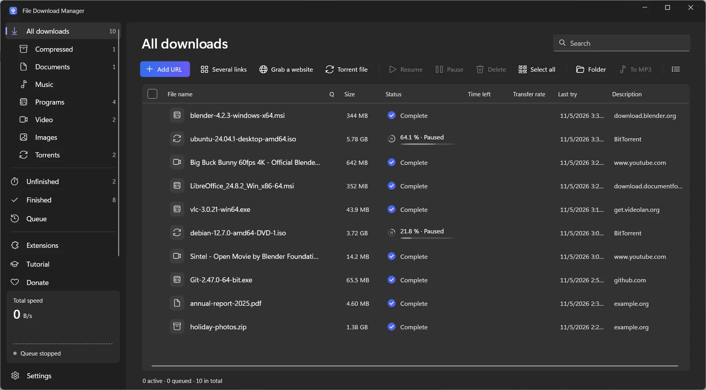

  

<h1 align="center">File Download Manager</h1>

<b>Der kostenlose Download-Manager für Windows, der alles kann</b> Kostenlos · Ohne Werbung · Windows 10 & 11

  
  
  

<a href="../../README.md">English</a> · <a href="README.fr.md">Français</a> · <a href="README.es.md">Español</a> · <a href="README.it.md">Italiano</a> · <a href="README.ar.md">العربية</a> · <a href="README.ru.md">Русский</a> · <a href="README.zh.md">中文（简体）</a> · <a href="README.hi.md">हिन्दी</a> · <a href="README.ja.md">日本語</a> · <a href="README.ko.md">한국어</a> · <b>Deutsch</b> · <a href="README.pt.md">Português</a> · <a href="README.he.md">עברית</a>

Beschleunigen Sie Downloads mit bis zu 32 Verbindungen pro Datei, setzen Sie jeden unterbrochenen Download fort, speichern Sie Videos von YouTube und über 1.000 Seiten in bis zu 4K oder als MP3 und laden Sie Torrents – alles in einer klaren, modernen App.

**[Für Windows herunterladen](https://filedownloadmanager.com/de/download)** · Für immer kostenlos. Kein Konto, keine Werbung, keine gebündelte Software.

## Alles, was Sie für schnellere Downloads brauchen

Von einer einzelnen Datei bis zur ganzen Website: File Download Manager erledigt es – und steht Ihnen nicht im Weg.

- **Beschleunigung mit mehreren Verbindungen** — Jede Datei wird in bis zu 32 Fragmente geteilt, die gleichzeitig geladen und danach automatisch zusammengefügt werden. Ideal für große ISO-Abbilder, Spiele und Videos.
- **Alles anhalten und fortsetzen** — Verbindung verloren, Energiesparmodus oder Neustart: Der Download geht genau dort weiter, wo er gestoppt hat, mit automatischen Wiederholungen.
- **YouTube und über 1.000 Videoseiten** — Wählen Sie die Qualität – bis 4K mit 60 fps – oder behalten Sie nur den Ton als MP3. Funktioniert mit YouTube, Facebook, Vimeo, X, TikTok, Twitch und vielen mehr.
- **Torrents und Magnet-Links** — Eine eingebaute BitTorrent-Engine lädt .torrent-Dateien und Magnet-Links mit DHT und Peer-Austausch. Kein separater Torrent-Client nötig.
- **Arbeitet mit Ihrem Browser** — Die Erweiterung für Chrome, Edge, Firefox, Brave, Opera und Vivaldi fängt Ihre Downloads ab und bietet an, das Video zu speichern, das Sie gerade ansehen.
- **Warteschlange und Zeitplaner** — Reihen Sie Downloads ein, legen Sie fest, wie viele gleichzeitig laufen, starten Sie die Warteschlange nachts und lassen Sie den PC danach schlafen oder herunterfahren.
- **Website-Grabber** — Speichern Sie eine ganze Website zum Offline-Lesen oder sammeln Sie nur die verlinkten Bilder, PDFs oder Archive.
- **Videostreams als MP4** — HLS-Streams (m3u8) werden Segment für Segment geladen und in eine einzige MP4-Datei umgewandelt.
- **Modern und in Ihrer Sprache** — Eine klare Windows-11-Oberfläche mit Dunkelmodus, Kategorien, Geschwindigkeitsbegrenzung und 13 Sprachen.

## Für Windows 11 gestaltet

Fluent Design, Mica, helles und dunkles Design: Es fühlt sich an wie ein Teil von Windows.

| | |
|---|---|
|  |  |
| Einfache, übersichtliche Einstellungen | Helles oder dunkles Design |

## In einer Minute bereit

1. **[Installieren](https://filedownloadmanager.com/de/download)** — Laden Sie das Installationsprogramm herunter und starten Sie es. Keine Administratorrechte nötig; die Video- und Torrent-Komponenten sind enthalten.
2. **[Erweiterung hinzufügen](https://filedownloadmanager.com/de/tutorial)** — Die App zeigt Ihnen Bild für Bild, wie Sie die Erweiterung zu Ihrem Browser hinzufügen.
3. **Herunterladen** — Klicken Sie auf einen Download-Link oder auf die Schaltfläche, die auf einem Video erscheint: File Download Manager übernimmt und ist schneller.

> Wenn Windows „Der Computer wurde durch Windows geschützt“ anzeigt, klicken Sie auf **Weitere Informationen** und dann auf **Trotzdem ausführen**: Das Installationsprogramm ist neu und SmartScreen noch nicht bekannt.

**Systemanforderungen:** Windows 10 oder 11 (64-Bit) · etwa 500 MB freier Speicherplatz · Internetverbindung.

## Eine kostenlose Alternative zu IDM

Sie suchen eine Alternative zu Internet Download Manager, Free Download Manager, JDownloader oder XDM? File Download Manager vereint Downloads mit mehreren Verbindungen, Browser-Erfassung, Video-Downloads und Torrents – kostenlos und ohne Werbung.

[Funktionen vergleichen →](https://filedownloadmanager.com/de/alternative)

## Häufige Fragen

<b>Ist File Download Manager wirklich kostenlos?</b>

Ja. Es gibt keine Testphase, keinen Lizenzschlüssel, keine Werbung und keine gebündelte Software. Das Projekt lebt von freiwilligen Spenden.

<b>Welche Windows-Versionen werden unterstützt?</b>

Windows 10 und Windows 11, 64-Bit. Die Video-, MP3- und Torrent-Komponenten sind im Installationsprogramm enthalten, und es werden keine Administratorrechte benötigt.

<b>Mit welchen Browsern funktioniert die Erweiterung?</b>

Google Chrome, Microsoft Edge, Mozilla Firefox, Brave, Opera und Vivaldi. Die bebilderte Anleitung zeigt, wie Sie sie mit wenigen Klicks hinzufügen.

<b>Kann es YouTube-Videos herunterladen und in MP3 umwandeln?</b>

Ja: YouTube und mehr als 1.000 Seiten, mit Wahl der Qualität (bis 4K, wenn verfügbar) oder nur MP3-Audio. Laden Sie nur Inhalte herunter, die Sie herunterladen dürfen, und beachten Sie das Urheberrecht und die Nutzungsbedingungen der Seiten. DRM-geschützte Dienste (Netflix, Disney+, Spotify…) werden nicht unterstützt.

<b>Kann ich einen abgebrochenen Download fortsetzen?</b>

Ja. Anhalten und Fortsetzen ist jederzeit möglich; nach einem Verbindungsabbruch oder Neustart geht der Download dort weiter, wo er stoppte, sofern der Server es erlaubt.

<b>Lädt es Torrents und Magnet-Links herunter?</b>

Ja. Öffnen Sie eine .torrent-Datei oder fügen Sie einen Magnet-Link ein: Die eingebaute BitTorrent-Engine übernimmt, ohne weitere Software.

<b>Ist es sicher? Warum zeigt Windows eine Warnung?</b>

Das Installationsprogramm ist neu und Microsoft SmartScreen noch nicht bekannt, daher zeigt Windows eventuell „Der Computer wurde durch Windows geschützt“: Klicken Sie auf **Weitere Informationen** und dann auf **Trotzdem ausführen**. Sie können die Datei mit ihrer SHA-256-Prüfsumme auf der Download-Seite prüfen. Die App wird nur für Ihr Konto installiert und lässt sich unter Einstellungen → Apps entfernen.

<b>Was ist der Unterschied zu IDM?</b>

Internet Download Manager ist kostenpflichtig. File Download Manager ist kostenlos und bietet außerdem Video-Downloads mit Qualitätswahl, MP3-Umwandlung, Torrents und eine moderne Windows-11-Oberfläche in 13 Sprachen.

## Gefällt Ihnen File Download Manager?

Er ist kostenlos und bleibt es. Eine kleine Spende hilft, ihn aktuell zu halten. **[Projekt unterstützen](https://filedownloadmanager.com/de/donate)**

## Links

- Offizielle Website: <https://filedownloadmanager.com/de/>
- [Anleitung](https://filedownloadmanager.com/de/tutorial)
- [Datenschutz](https://filedownloadmanager.com/de/privacy)
- [Alle Versionen und SHA-256-Prüfsummen: GitHub Releases](https://github.com/Oussama4422/FileDownloadManager/releases)
- [Versionsverlauf (auf Französisch)](../../docs/CHANGELOG.fr.md)

---

Alle genannten Produktnamen sind Marken ihrer jeweiligen Inhaber. File Download Manager steht in keiner Verbindung zu ihnen.
