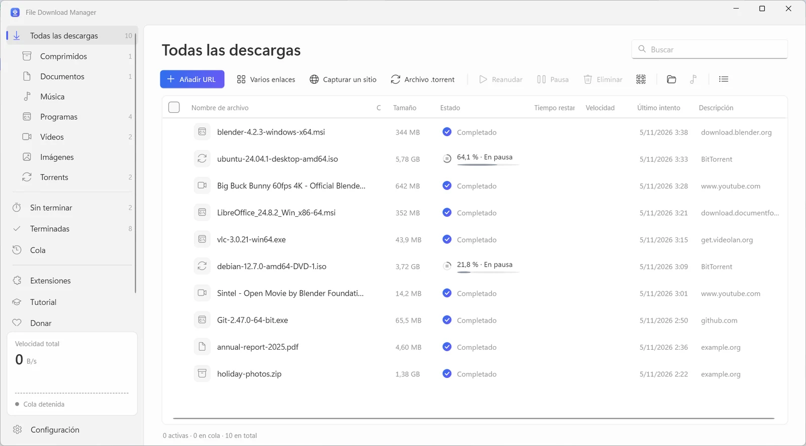
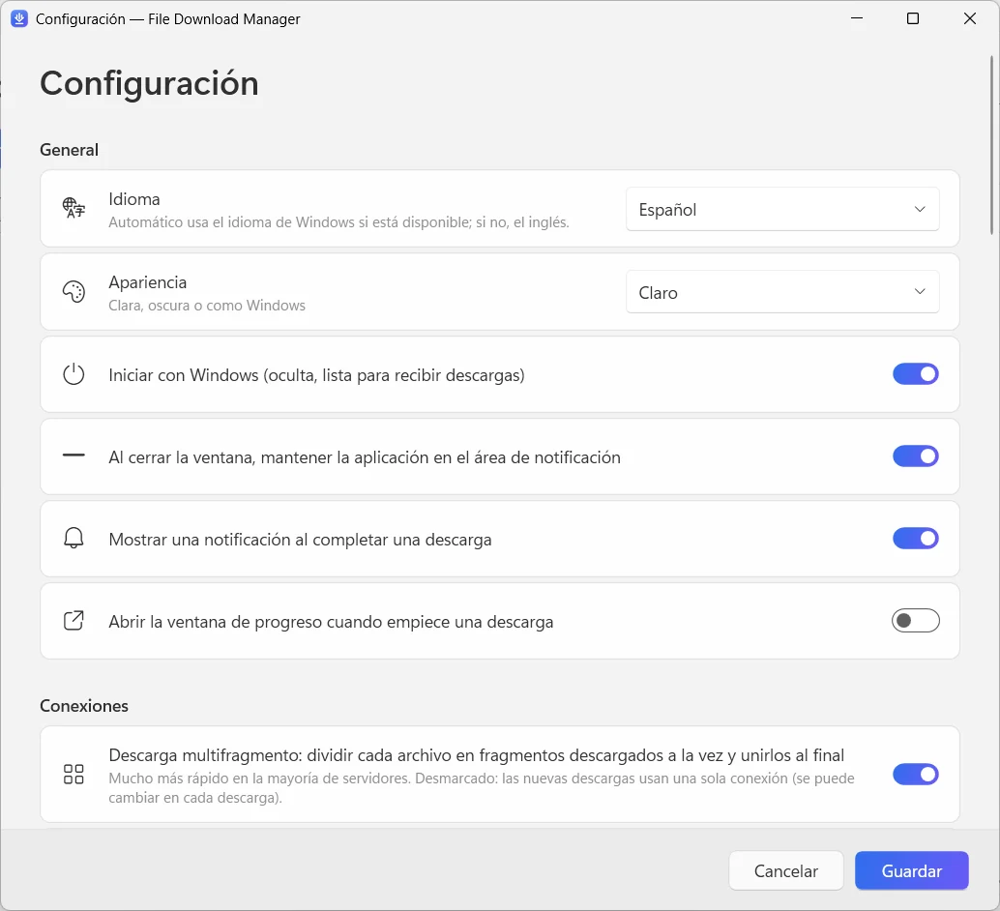

  

<h1 align="center">File Download Manager</h1>

<b>El gestor de descargas gratis para Windows que lo hace todo</b> Gratis · Sin anuncios · Windows 10 y 11

  
  
  

<a href="../../README.md">English</a> · <a href="README.fr.md">Français</a> · <b>Español</b> · <a href="README.it.md">Italiano</a> · <a href="README.ar.md">العربية</a> · <a href="README.ru.md">Русский</a> · <a href="README.zh.md">中文（简体）</a> · <a href="README.hi.md">हिन्दी</a> · <a href="README.ja.md">日本語</a> · <a href="README.ko.md">한국어</a> · <a href="README.de.md">Deutsch</a> · <a href="README.pt.md">Português</a> · <a href="README.he.md">עברית</a>

Acelera tus descargas con hasta 32 conexiones por archivo, reanuda todo lo que se haya interrumpido, guarda videos de YouTube y más de 1000 sitios hasta en 4K o en MP3, y descarga torrents, todo en una aplicación limpia y moderna.

**[Descargar para Windows](https://filedownloadmanager.com/es/download)** · Gratis para siempre. Sin cuenta, sin anuncios, sin programas añadidos.

## Todo lo que necesitas para descargar más rápido

De un solo archivo a un sitio web entero, File Download Manager se encarga de todo sin estorbar.

- **Aceleración con varias conexiones** — Cada archivo se divide en hasta 32 fragmentos que se descargan a la vez y se unen automáticamente. Ideal para imágenes ISO, juegos y videos grandes.
- **Pausa y reanuda lo que quieras** — Conexión perdida, suspensión o reinicio: la descarga continúa justo donde se detuvo, con reintentos automáticos.
- **YouTube y más de 1000 sitios de video** — Elige la calidad, hasta 4K a 60 fps, o conserva solo el sonido en MP3. Funciona con YouTube, Facebook, Vimeo, X, TikTok, Twitch y muchos más.
- **Torrents y enlaces magnet** — Un motor BitTorrent integrado descarga archivos .torrent y enlaces magnet con DHT e intercambio de pares. No necesitas otro cliente de torrents.
- **Integrado con tu navegador** — La extensión para Chrome, Edge, Firefox, Brave, Opera y Vivaldi captura tus descargas y ofrece guardar el video que estás viendo.
- **Cola y programador** — Organiza tus descargas, elige cuántas se ejecutan a la vez, inicia la cola por la noche y deja que el PC se suspenda o se apague al terminar.
- **Capturador de sitios web** — Guarda un sitio completo para leerlo sin conexión, o recoge solo las imágenes, PDF o archivos que enlaza.
- **Transmisiones de video a MP4** — Las transmisiones HLS (m3u8) se descargan segmento a segmento y se convierten en un único archivo MP4.
- **Moderno y en tu idioma** — Una interfaz cuidada de Windows 11 con modo oscuro, categorías, limitador de velocidad y 13 idiomas.

## Diseñado para Windows 11

Diseño Fluent, efecto Mica, temas claro y oscuro: parece parte de Windows.

| | |
|---|---|
|  |  |
| Ajustes simples y claros | Tema claro u oscuro |

## Listo en un minuto

1. **[Instalar](https://filedownloadmanager.com/es/download)** — Descarga el instalador y ejecútalo. No necesitas derechos de administrador; los componentes de video y torrent están incluidos.
2. **[Añadir la extensión](https://filedownloadmanager.com/es/tutorial)** — La aplicación te muestra, imagen por imagen, cómo añadir la extensión a tu navegador.
3. **Descargar** — Haz clic en un enlace de descarga o en el botón que aparece sobre un video: File Download Manager toma el relevo y va más rápido.

> Si Windows muestra «Windows protegió su PC», haz clic en **Más información** y luego en **Ejecutar de todas formas**: el instalador es nuevo y SmartScreen aún no lo conoce.

**Requisitos del sistema:** Windows 10 u 11 (64 bits) · unos 500 MB libres · conexión a Internet.

## Una alternativa gratuita a IDM

¿Buscas una alternativa a Internet Download Manager, Free Download Manager, JDownloader o XDM? File Download Manager reúne descargas con varias conexiones, captura desde el navegador, videos y torrents, gratis y sin anuncios.

[Comparar las funciones →](https://filedownloadmanager.com/es/alternative)

## Preguntas frecuentes

<b>¿File Download Manager es realmente gratis?</b>

Sí. No hay periodo de prueba, ni clave de licencia, ni anuncios, ni programas añadidos. El proyecto vive de donaciones voluntarias.

<b>¿Qué versiones de Windows son compatibles?</b>

Windows 10 y Windows 11 de 64 bits. Los componentes de video, MP3 y torrent vienen en el instalador y no se necesitan derechos de administrador.

<b>¿Qué navegadores funcionan con la extensión?</b>

Google Chrome, Microsoft Edge, Mozilla Firefox, Brave, Opera y Vivaldi. El tutorial ilustrado muestra cómo añadirla en unos clics.

<b>¿Puede descargar videos de YouTube y convertirlos a MP3?</b>

Sí: YouTube y más de 1000 sitios, eligiendo la calidad (hasta 4K cuando está disponible) o solo el audio en MP3. Descarga solo contenidos que tengas derecho a descargar y respeta los derechos de autor y las condiciones de los sitios. Los servicios con DRM (Netflix, Disney+, Spotify…) no son compatibles.

<b>¿Puedo reanudar una descarga que se detuvo?</b>

Sí. Pausa y reanuda cuando quieras; tras un corte o un reinicio, la descarga continúa donde se detuvo si el servidor lo permite.

<b>¿Descarga torrents y enlaces magnet?</b>

Sí. Abre un archivo .torrent o pega un enlace magnet: el motor BitTorrent integrado se encarga, sin instalar otro programa.

<b>¿Es seguro? ¿Por qué Windows muestra una advertencia?</b>

El instalador es nuevo y Microsoft SmartScreen aún no lo conoce, así que Windows puede mostrar «Windows protegió su PC»: haz clic en **Más información** y luego en **Ejecutar de todas formas**. Puedes comprobar el archivo con su suma SHA-256 en la página de descarga. La aplicación se instala solo para tu cuenta y se desinstala desde Configuración → Aplicaciones.

<b>¿En qué se diferencia de IDM?</b>

Internet Download Manager es un programa de pago. File Download Manager es gratuito e incluye además descarga de videos con elección de calidad, conversión a MP3, torrents y una interfaz moderna de Windows 11 en 13 idiomas.

## ¿Te gusta File Download Manager?

Es gratis y seguirá siéndolo. Una pequeña donación ayuda a mantenerlo actualizado. **[Apoyar el proyecto](https://filedownloadmanager.com/es/donate)**

## Enlaces

- Sitio web oficial: <https://filedownloadmanager.com/es/>
- [Tutorial](https://filedownloadmanager.com/es/tutorial)
- [Privacidad](https://filedownloadmanager.com/es/privacy)
- [Todas las versiones y sumas SHA-256: GitHub Releases](https://github.com/Oussama4422/FileDownloadManager/releases)
- [Historial de versiones (en francés)](../../docs/CHANGELOG.fr.md)

---

Los nombres de productos mencionados son marcas de sus respectivos propietarios. File Download Manager no está afiliado a ellos.
