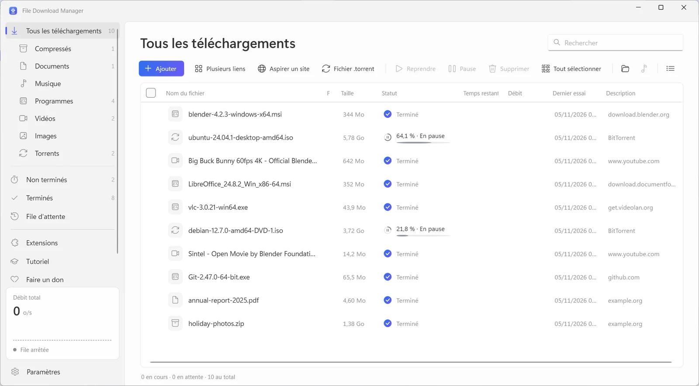
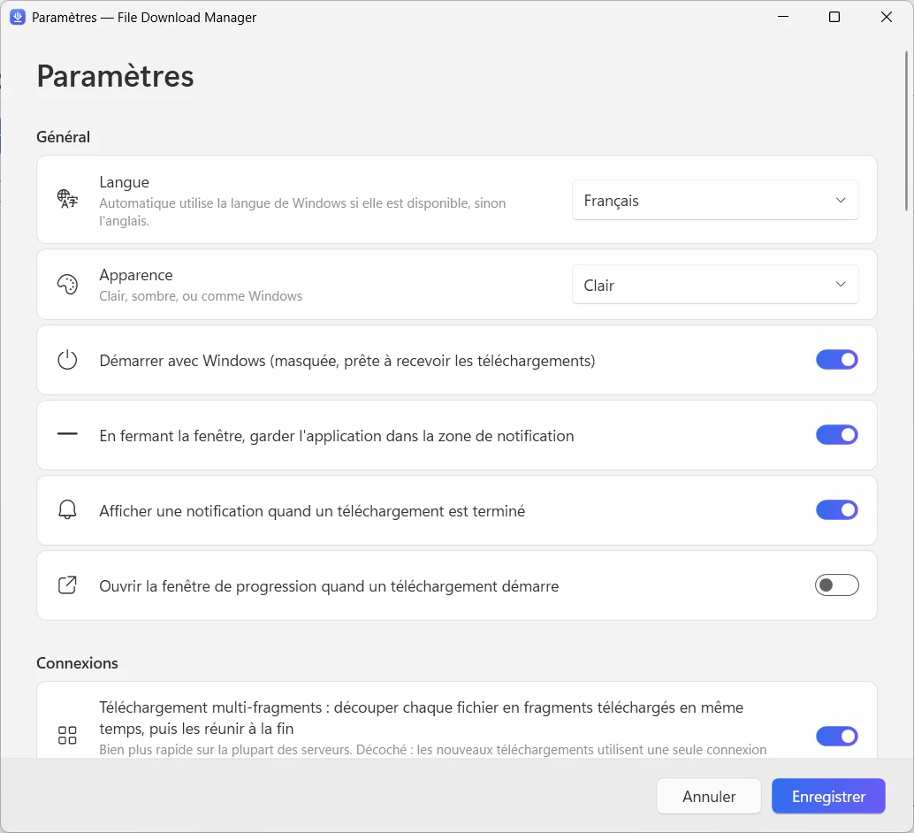

  

<h1 align="center">File Download Manager</h1>

<b>Le gestionnaire de téléchargement gratuit qui fait tout</b> Gratuit · Sans pub · Windows 10 et 11

  
  
  

<a href="../../README.md">English</a> · <b>Français</b> · <a href="README.es.md">Español</a> · <a href="README.it.md">Italiano</a> · <a href="README.ar.md">العربية</a> · <a href="README.ru.md">Русский</a> · <a href="README.zh.md">中文（简体）</a> · <a href="README.hi.md">हिन्दी</a> · <a href="README.ja.md">日本語</a> · <a href="README.ko.md">한국어</a> · <a href="README.de.md">Deutsch</a> · <a href="README.pt.md">Português</a> · <a href="README.he.md">עברית</a>

Accélérez vos téléchargements avec jusqu'à 32 connexions par fichier, reprenez tout ce qui a été interrompu, enregistrez les vidéos de YouTube et de plus de 1 000 sites jusqu'en 4K ou en MP3, et téléchargez vos torrents — dans une seule application, claire et moderne.

**[Télécharger pour Windows](https://filedownloadmanager.com/fr/download)** · Gratuit pour toujours. Sans compte, sans pub, sans logiciel ajouté.

## Tout pour télécharger plus vite

D'un simple fichier à un site entier, File Download Manager s'occupe de tout — sans vous déranger.

- **Accélération multi-connexions** — Chaque fichier est découpé en jusqu'à 32 fragments téléchargés en même temps, puis réunis automatiquement. Idéal pour les images ISO, les jeux et les vidéos.
- **Pause et reprise de tout** — Connexion perdue, mise en veille ou redémarrage : le téléchargement reprend exactement où il s'était arrêté, avec de nouvelles tentatives automatiques.
- **YouTube et plus de 1 000 sites vidéo** — Choisissez la qualité — jusqu'à la 4K en 60 i/s — ou gardez seulement le son en MP3. Fonctionne avec YouTube, Facebook, Vimeo, X, TikTok, Twitch et bien d'autres.
- **Torrents et liens magnet** — Un moteur BitTorrent intégré télécharge les fichiers .torrent et les liens magnet avec DHT et échange de pairs. Aucun autre client torrent nécessaire.
- **Intégré à votre navigateur** — L'extension pour Chrome, Edge, Firefox, Brave, Opera et Vivaldi capte vos téléchargements et propose d'enregistrer la vidéo que vous regardez.
- **File d'attente et planificateur** — Alignez vos téléchargements, choisissez combien tournent en même temps, lancez la file la nuit et laissez le PC se mettre en veille ou s'éteindre à la fin.
- **Aspirateur de site** — Enregistrez un site entier pour le lire hors ligne, ou récupérez seulement les images, PDF ou archives qu'il contient.
- **Flux vidéo en MP4** — Les flux HLS (m3u8) sont téléchargés segment par segment puis convertis en un seul fichier MP4.
- **Moderne et dans votre langue** — Une interface Windows 11 soignée avec mode sombre, catégories, limiteur de vitesse et 13 langues.

## Pensé pour Windows 11

Design Fluent, effet Mica, thèmes clair et sombre : on dirait une partie de Windows.

| | |
|---|---|
|  |  |
| Des réglages simples et clairs | Thème clair ou sombre |

## Prêt en une minute

1. **[Installer](https://filedownloadmanager.com/fr/download)** — Téléchargez l'installateur et lancez-le. Aucun droit administrateur nécessaire ; les composants vidéo et torrent sont inclus.
2. **[Ajouter l'extension](https://filedownloadmanager.com/fr/tutorial)** — L'application vous montre, image par image, comment ajouter l'extension à votre navigateur.
3. **Télécharger** — Cliquez sur un lien de téléchargement ou sur le bouton qui apparaît sur une vidéo : File Download Manager prend le relais et va plus vite.

> Si Windows affiche « Windows a protégé votre ordinateur », cliquez sur **Informations complémentaires** puis **Exécuter quand même** : l'installateur est récent et pas encore connu de SmartScreen.

**Configuration requise** : Windows 10 ou 11 (64 bits) · environ 500 Mo d'espace libre · connexion Internet.

## Une alternative gratuite à IDM

Vous cherchez une alternative à Internet Download Manager, Free Download Manager, JDownloader ou XDM ? File Download Manager réunit téléchargements multi-connexions, capture depuis le navigateur, vidéos et torrents — gratuitement et sans pub.

[Comparer les fonctions →](https://filedownloadmanager.com/fr/alternative)

## Questions fréquentes

<b>File Download Manager est-il vraiment gratuit ?</b>

Oui. Pas de période d'essai, pas de clé de licence, pas de publicité et aucun logiciel ajouté. Le projet vit grâce aux dons volontaires.

<b>Quelles versions de Windows sont prises en charge ?</b>

Windows 10 et Windows 11, 64 bits. Les composants vidéo, MP3 et torrent sont inclus dans l'installateur, et aucun droit administrateur n'est nécessaire.

<b>Quels navigateurs fonctionnent avec l'extension ?</b>

Google Chrome, Microsoft Edge, Mozilla Firefox, Brave, Opera et Vivaldi. Le tutoriel illustré montre comment l'ajouter en quelques clics.

<b>Peut-il télécharger les vidéos YouTube et les convertir en MP3 ?</b>

Oui : YouTube et plus de 1 000 sites, avec le choix de la qualité (jusqu'en 4K si disponible) ou le son seul en MP3. Ne téléchargez que les contenus que vous avez le droit de télécharger, dans le respect du droit d'auteur et des conditions des sites. Les services protégés par DRM (Netflix, Disney+, Spotify…) ne sont pas pris en charge.

<b>Puis-je reprendre un téléchargement interrompu ?</b>

Oui. Mettez en pause et reprenez quand vous voulez ; après une coupure ou un redémarrage, le téléchargement continue là où il s'était arrêté, si le serveur le permet.

<b>Télécharge-t-il les torrents et les liens magnet ?</b>

Oui. Ouvrez un fichier .torrent ou collez un lien magnet : le moteur BitTorrent intégré s'en charge, sans autre logiciel à installer.

<b>Est-ce sûr ? Pourquoi Windows affiche-t-il un avertissement ?</b>

L'installateur est récent et pas encore connu de Microsoft SmartScreen : Windows peut afficher « Windows a protégé votre ordinateur ». Cliquez sur **Informations complémentaires** puis **Exécuter quand même**. Vous pouvez vérifier le fichier grâce à son empreinte SHA-256 sur la page de téléchargement. L'application s'installe pour votre compte uniquement et se désinstalle depuis Paramètres → Applications.

<b>Quelle différence avec IDM ?</b>

Internet Download Manager est un logiciel payant. File Download Manager est gratuit et ajoute le téléchargement de vidéos avec choix de la qualité, la conversion MP3, les torrents et une interface Windows 11 moderne en 13 langues.

## File Download Manager vous plaît ?

Il est gratuit et le restera. Un petit don aide à le maintenir à jour. **[Soutenir le projet](https://filedownloadmanager.com/fr/donate)**

## Liens

- Site officiel : <https://filedownloadmanager.com/fr/>
- [Tutoriel](https://filedownloadmanager.com/fr/tutorial)
- [Confidentialité](https://filedownloadmanager.com/fr/privacy)
- [Toutes les versions et empreintes SHA-256 : GitHub Releases](https://github.com/Oussama4422/FileDownloadManager/releases)
- [Historique des versions](../../docs/CHANGELOG.fr.md)

---

Les noms de produits cités sont des marques de leurs propriétaires respectifs. File Download Manager n'y est pas affilié.
