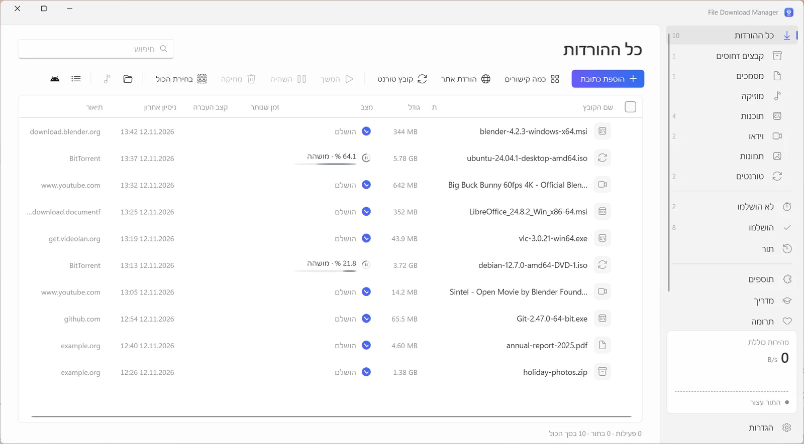
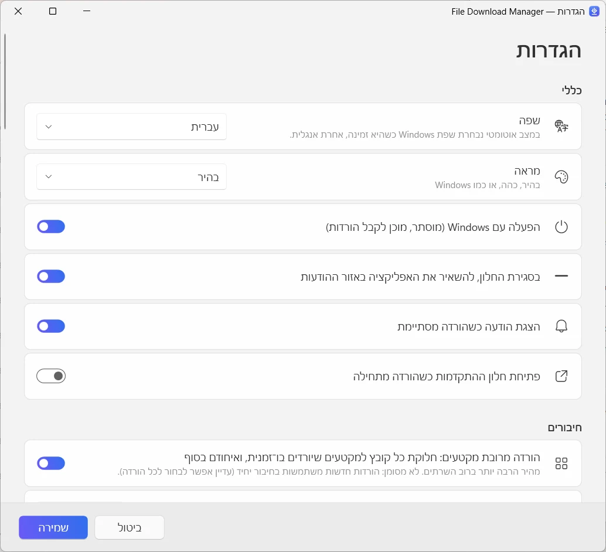

  

<h1 align="center">File Download Manager</h1>

<b>מנהל ההורדות החינמי ל‑Windows שעושה הכול</b> חינם · בלי פרסומות · Windows 10 ו-11

  
  
  

<a href="../../README.md">English</a> · <a href="README.fr.md">Français</a> · <a href="README.es.md">Español</a> · <a href="README.it.md">Italiano</a> · <a href="README.ar.md">العربية</a> · <a href="README.ru.md">Русский</a> · <a href="README.zh.md">中文（简体）</a> · <a href="README.hi.md">हिन्दी</a> · <a href="README.ja.md">日本語</a> · <a href="README.ko.md">한국어</a> · <a href="README.de.md">Deutsch</a> · <a href="README.pt.md">Português</a> · <b>עברית</b>

האיצו הורדות עם עד 32 חיבורים לכל קובץ, המשיכו כל הורדה שנקטעה, שמרו סרטונים מיוטיוב ומיותר מ-1,000 אתרים באיכות של עד 4K או כ-MP3, והורידו טורנטים – הכול באפליקציה אחת, נקייה ומודרנית.

**[הורדה ל-Windows](https://filedownloadmanager.com/he/download)** · חינם לתמיד. בלי חשבון, בלי פרסומות, בלי תוכנות נלוות.

## כל מה שצריך כדי להוריד מהר יותר

מקובץ בודד ועד אתר שלם, File Download Manager מטפל בהכול – בלי להפריע לכם.

- **האצה בחיבורים מרובים** — כל קובץ מחולק לעד 32 חלקים שיורדים בו-זמנית ומתחברים אוטומטית בסוף. אידיאלי לקובצי ISO גדולים, למשחקים ולסרטונים.
- **השהיה והמשך של כל הורדה** — החיבור נפל, המחשב נכנס לשינה או הופעל מחדש: ההורדה ממשיכה בדיוק מהמקום שבו נעצרה, עם ניסיונות חוזרים אוטומטיים.
- **יוטיוב ויותר מ-1,000 אתרי וידאו** — בחרו את האיכות – עד 4K ב-60 פריימים לשנייה – או שמרו רק את הצליל כ-MP3. עובד עם YouTube, ‏Facebook, ‏Vimeo, ‏X, ‏TikTok, ‏Twitch ועוד הרבה.
- **טורנטים וקישורי מגנט** — מנוע BitTorrent מובנה מוריד קובצי ‎.torrent וקישורי מגנט עם DHT והחלפת עמיתים. אין צורך בתוכנת טורנט נפרדת.
- **עובד עם הדפדפן שלכם** — התוסף ל-Chrome, ‏Edge, ‏Firefox, ‏Brave, ‏Opera ו-Vivaldi קולט את ההורדות שלכם ומציע לשמור את הסרטון שאתם צופים בו.
- **תור ותזמון** — הוסיפו הורדות לתור, בחרו כמה ירוצו במקביל, הפעילו את התור בלילה ותנו למחשב לעבור לשינה או לכבות כשהכול מסתיים.
- **שמירת אתרים** — שמרו אתר שלם לקריאה ללא חיבור, או אספו רק את התמונות, קובצי ה-PDF או הארכיונים שהוא מקשר אליהם.
- **זרמי וידאו ל-MP4** — זרמי HLS ‏(m3u8) יורדים מקטע אחר מקטע ומומרים לקובץ MP4 אחד.
- **מודרני ובשפה שלכם** — ממשק Windows 11 נקי עם מצב כהה, קטגוריות, הגבלת מהירות ו-13 שפות.

## עוצב בשביל Windows 11

Fluent Design, ‏Mica, ערכות נושא בהירה וכהה: מרגיש כמו חלק מ-Windows.

| | |
|---|---|
|  |  |
| הגדרות פשוטות וברורות | ערכת נושא בהירה או כהה |

## מוכן תוך דקה

1. **[התקנה](https://filedownloadmanager.com/he/download)** — הורידו את קובץ ההתקנה והפעילו אותו. לא נדרשות הרשאות מנהל; רכיבי הווידאו והטורנט כלולים.
2. **[הוספת התוסף](https://filedownloadmanager.com/he/tutorial)** — האפליקציה מראה לכם, תמונה אחר תמונה, איך להוסיף את התוסף לדפדפן.
3. **הורדה** — לחצו על קישור הורדה או על הכפתור שמופיע על סרטון: File Download Manager לוקח פיקוד ומוריד מהר יותר.

> אם Windows מציג „Windows הגן על המחשב שלך”, לחצו על **מידע נוסף** ואז על **הפעל בכל מקרה**: קובץ ההתקנה חדש ועדיין אינו מוכר ל-SmartScreen.

**דרישות מערכת:** ‏Windows 10 או 11 ‏(64 סיביות) · כ-500 MB פנויים · חיבור לאינטרנט.

## חלופה חינמית ל-IDM

מחפשים חלופה ל-Internet Download Manager, ‏Free Download Manager, ‏JDownloader או XDM? ‏File Download Manager מאחד הורדות בחיבורים מרובים, קליטה מהדפדפן, הורדת סרטונים וטורנטים – בחינם ובלי פרסומות.

[השוואת התכונות →](https://filedownloadmanager.com/he/alternative)

## שאלות נפוצות

<b>האם File Download Manager באמת חינמי?</b>

כן. אין תקופת ניסיון, אין מפתח רישיון, אין פרסומות ואין תוכנות נלוות. הפרויקט מתקיים מתרומות.

<b>באילו גרסאות של Windows הוא עובד?</b>

‏Windows 10 ו-Windows 11, ‏64 סיביות. רכיבי הווידאו, ה-MP3 והטורנט כלולים בקובץ ההתקנה, ולא נדרשות הרשאות מנהל.

<b>באילו דפדפנים התוסף עובד?</b>

‏Google Chrome, ‏Microsoft Edge, ‏Mozilla Firefox, ‏Brave, ‏Opera ו-Vivaldi. המדריך המאויר מראה איך להוסיף אותו בכמה לחיצות.

<b>האם אפשר להוריד סרטוני יוטיוב ולהמיר אותם ל-MP3?</b>

כן: יוטיוב ויותר מ-1,000 אתרים, עם בחירת איכות (עד 4K כשזמין) או שמע בלבד ב-MP3. הורידו רק תוכן שמותר לכם להוריד, ושמרו על זכויות היוצרים ועל תנאי השימוש של האתרים. שירותים המוגנים ב-DRM ‏(Netflix, ‏Disney+‎, ‏Spotify…) אינם נתמכים.

<b>אפשר להמשיך הורדה שנעצרה?</b>

כן. אפשר להשהות ולהמשיך בכל רגע; אחרי ניתוק או הפעלה מחדש, ההורדה ממשיכה מהמקום שבו נעצרה, כל עוד השרת מאפשר זאת.

<b>האם הוא מוריד טורנטים וקישורי מגנט?</b>

כן. פתחו קובץ ‎.torrent או הדביקו קישור מגנט: מנוע ה-BitTorrent המובנה מטפל בזה, בלי להתקין תוכנה נוספת.

<b>האם זה בטוח? למה Windows מציג אזהרה?</b>

קובץ ההתקנה חדש ועדיין אינו מוכר ל-Microsoft SmartScreen, ולכן Windows עשוי להציג „Windows הגן על המחשב שלך”: לחצו על **מידע נוסף** ואז על **הפעל בכל מקרה**. אפשר לבדוק את הקובץ לפי סיכום הביקורת SHA-256 שלו בדף ההורדה. האפליקציה מותקנת לחשבון שלכם בלבד, ואפשר להסיר אותה בהגדרות ← אפליקציות.

<b>במה הוא שונה מ-IDM?</b>

‏Internet Download Manager היא תוכנה בתשלום. File Download Manager חינמי וכולל גם הורדת סרטונים עם בחירת איכות, המרה ל-MP3, טורנטים וממשק Windows 11 מודרני ב-13 שפות.

## אוהבים את File Download Manager?

הוא חינמי ויישאר חינמי. תרומה קטנה עוזרת לשמור אותו מעודכן. **[תמיכה בפרויקט](https://filedownloadmanager.com/he/donate)**

## קישורים

- האתר הרשמי: <https://filedownloadmanager.com/he/>
- [מדריך](https://filedownloadmanager.com/he/tutorial)
- [פרטיות](https://filedownloadmanager.com/he/privacy)
- [כל הגרסאות וסכומי הבדיקה SHA-256: ‏GitHub Releases](https://github.com/Oussama4422/FileDownloadManager/releases)
- [היסטוריית הגרסאות (בצרפתית)](../../docs/CHANGELOG.fr.md)

---

כל שמות המוצרים המוזכרים הם סימנים מסחריים של בעליהם. File Download Manager אינו קשור אליהם.

