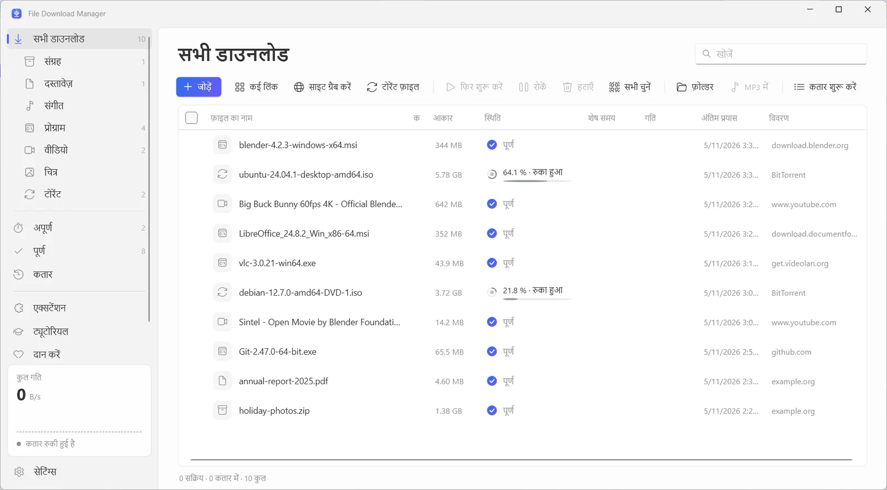
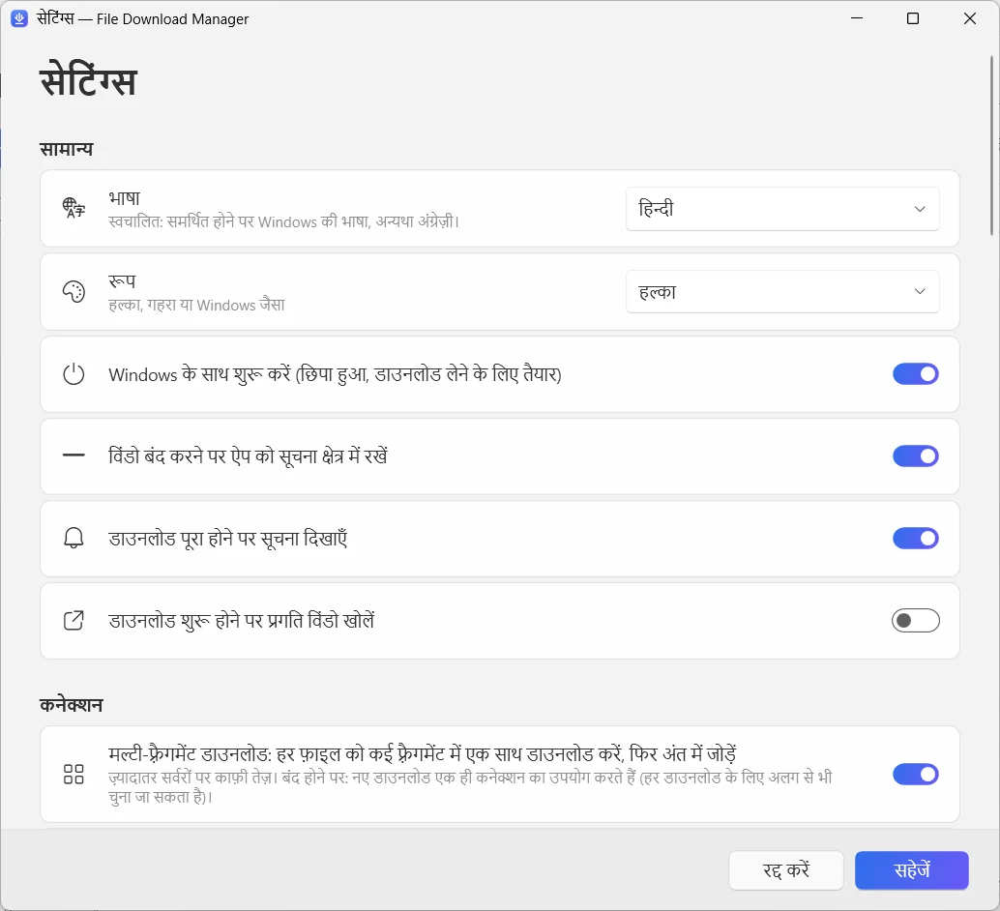

  

<h1 align="center">File Download Manager</h1>

<b>Windows के लिए फ्री डाउनलोड मैनेजर, जो सब कुछ करता है</b> फ्री · बिना विज्ञापन · Windows 10 और 11

  
  
  

<a href="../../README.md">English</a> · <a href="README.fr.md">Français</a> · <a href="README.es.md">Español</a> · <a href="README.it.md">Italiano</a> · <a href="README.ar.md">العربية</a> · <a href="README.ru.md">Русский</a> · <a href="README.zh.md">中文（简体）</a> · <b>हिन्दी</b> · <a href="README.ja.md">日本語</a> · <a href="README.ko.md">한국어</a> · <a href="README.de.md">Deutsch</a> · <a href="README.pt.md">Português</a> · <a href="README.he.md">עברית</a>

हर फ़ाइल के लिए 32 तक कनेक्शन से डाउनलोड तेज़ करें, रुके हुए डाउनलोड वहीं से फिर शुरू करें, YouTube और 1,000+ साइटों से 4K तक के वीडियो या MP3 सहेजें, और टोरेंट डाउनलोड करें — सब एक साफ़-सुथरे, आधुनिक ऐप में।

**[Windows के लिए डाउनलोड करें](https://filedownloadmanager.com/hi/download)** · हमेशा के लिए फ्री। न खाता, न विज्ञापन, न कोई अतिरिक्त सॉफ़्टवेयर।

## तेज़ डाउनलोड के लिए ज़रूरी हर चीज़

एक फ़ाइल से लेकर पूरी वेबसाइट तक, File Download Manager सब संभालता है — और आपको परेशान नहीं करता।

- **मल्टी-कनेक्शन एक्सेलेरेशन** — हर फ़ाइल को 32 तक हिस्सों में बाँटकर एक साथ डाउनलोड किया जाता है, फिर अपने-आप जोड़ा जाता है। बड़ी ISO इमेज, गेम और वीडियो के लिए बढ़िया।
- **कभी भी रोकें और फिर शुरू करें** — कनेक्शन टूटे, कंप्यूटर स्लीप हो या रीस्टार्ट हो: डाउनलोड ठीक वहीं से जारी रहता है जहाँ रुका था, अपने-आप पुनः प्रयास के साथ।
- **YouTube और 1,000+ वीडियो साइटें** — गुणवत्ता चुनें — 60 fps पर 4K तक — या सिर्फ़ आवाज़ MP3 में रखें। YouTube, Facebook, Vimeo, X, TikTok, Twitch और कई अन्य साइटों पर काम करता है।
- **टोरेंट और मैग्नेट लिंक** — बिल्ट-इन BitTorrent इंजन DHT और पीयर एक्सचेंज के साथ .torrent फ़ाइलें और मैग्नेट लिंक डाउनलोड करता है। अलग टोरेंट क्लाइंट की ज़रूरत नहीं।
- **आपके ब्राउज़र के साथ** — Chrome, Edge, Firefox, Brave, Opera और Vivaldi का एक्सटेंशन आपके डाउनलोड पकड़ता है और जो वीडियो आप देख रहे हैं उसे सहेजने का विकल्प देता है।
- **कतार और शेड्यूलर** — डाउनलोड कतार में लगाएँ, तय करें कि एक साथ कितने चलें, रात में कतार शुरू करें और काम पूरा होने पर PC को स्लीप या बंद होने दें।
- **वेबसाइट ग्रैबर** — पूरी वेबसाइट ऑफ़लाइन पढ़ने के लिए सहेजें, या सिर्फ़ उसमें जुड़ी तस्वीरें, PDF या आर्काइव इकट्ठा करें।
- **वीडियो स्ट्रीम से MP4** — HLS (m3u8) स्ट्रीम सेगमेंट-दर-सेगमेंट डाउनलोड होकर एक MP4 फ़ाइल में बदल जाती हैं।
- **आधुनिक और आपकी भाषा में** — डार्क मोड, श्रेणियों, स्पीड लिमिटर और 13 भाषाओं के साथ साफ़-सुथरा Windows 11 इंटरफ़ेस।

## Windows 11 के लिए बना

Fluent डिज़ाइन, Mica इफ़ेक्ट, हल्की और गहरी थीम: लगता है जैसे Windows का ही हिस्सा हो।

| | |
|---|---|
|  |  |
| आसान और साफ़ सेटिंग्स | हल्की या गहरी थीम |

## एक मिनट में तैयार

1. **[इंस्टॉल करें](https://filedownloadmanager.com/hi/download)** — इंस्टॉलर डाउनलोड करके चलाएँ। व्यवस्थापक अधिकार की ज़रूरत नहीं; वीडियो और टोरेंट घटक साथ में शामिल हैं।
2. **[एक्सटेंशन जोड़ें](https://filedownloadmanager.com/hi/tutorial)** — ऐप चित्रों के साथ दिखाता है कि अपने ब्राउज़र में एक्सटेंशन कैसे जोड़ें।
3. **डाउनलोड करें** — किसी डाउनलोड लिंक पर या वीडियो पर दिखने वाले बटन पर क्लिक करें: File Download Manager काम सँभाल लेता है और तेज़ी से डाउनलोड करता है।

> अगर Windows “Windows ने आपके PC को सुरक्षित किया” दिखाए, तो **अधिक जानकारी** पर, फिर **फिर भी चलाएँ** पर क्लिक करें: इंस्टॉलर नया है और SmartScreen इसे अभी नहीं पहचानता।

**सिस्टम आवश्यकताएँ:** Windows 10 या 11 (64-बिट) · लगभग 500 MB खाली जगह · इंटरनेट कनेक्शन।

## IDM का फ्री विकल्प

Internet Download Manager, Free Download Manager, JDownloader या XDM का विकल्प ढूँढ रहे हैं? File Download Manager मल्टी-कनेक्शन डाउनलोड, ब्राउज़र से कैप्चर, वीडियो और टोरेंट सब एक साथ देता है — फ्री और बिना विज्ञापन।

[सुविधाओं की तुलना करें →](https://filedownloadmanager.com/hi/alternative)

## अक्सर पूछे जाने वाले प्रश्न

<b>क्या File Download Manager सच में फ्री है?</b>

हाँ। न ट्रायल पीरियड, न लाइसेंस की, न विज्ञापन और न कोई अतिरिक्त सॉफ़्टवेयर। यह प्रोजेक्ट स्वैच्छिक दान से चलता है।

<b>Windows के कौन-से संस्करण समर्थित हैं?</b>

Windows 10 और Windows 11, 64-बिट। वीडियो, MP3 और टोरेंट घटक इंस्टॉलर में शामिल हैं, और व्यवस्थापक अधिकार की ज़रूरत नहीं है।

<b>एक्सटेंशन किन ब्राउज़रों में काम करता है?</b>

Google Chrome, Microsoft Edge, Mozilla Firefox, Brave, Opera और Vivaldi। चित्रों वाला ट्यूटोरियल दिखाता है कि इसे कुछ क्लिक में कैसे जोड़ें।

<b>क्या यह YouTube वीडियो डाउनलोड करके MP3 में बदल सकता है?</b>

हाँ: YouTube और 1,000 से ज़्यादा साइटें, गुणवत्ता चुनने (उपलब्ध होने पर 4K तक) या सिर्फ़ MP3 ऑडियो के विकल्प के साथ। केवल वही सामग्री डाउनलोड करें जिसे डाउनलोड करने का आपको अधिकार है, और कॉपीराइट व साइटों की शर्तों का सम्मान करें। DRM से सुरक्षित सेवाएँ (Netflix, Disney+, Spotify…) समर्थित नहीं हैं।

<b>क्या रुका हुआ डाउनलोड फिर से शुरू हो सकता है?</b>

हाँ। जब चाहें रोकें और फिर शुरू करें; कनेक्शन टूटने या रीस्टार्ट के बाद भी डाउनलोड वहीं से जारी रहता है, अगर सर्वर अनुमति देता है।

<b>क्या यह टोरेंट और मैग्नेट लिंक डाउनलोड करता है?</b>

हाँ। .torrent फ़ाइल खोलें या मैग्नेट लिंक चिपकाएँ: बिल्ट-इन BitTorrent इंजन बाकी काम करता है, कोई और सॉफ़्टवेयर इंस्टॉल करने की ज़रूरत नहीं।

<b>क्या यह सुरक्षित है? Windows चेतावनी क्यों दिखाता है?</b>

इंस्टॉलर नया है और Microsoft SmartScreen इसे अभी नहीं पहचानता, इसलिए Windows “Windows ने आपके PC को सुरक्षित किया” दिखा सकता है: **अधिक जानकारी** पर, फिर **फिर भी चलाएँ** पर क्लिक करें। डाउनलोड पेज पर दिए SHA-256 चेकसम से आप फ़ाइल जाँच सकते हैं। ऐप केवल आपके खाते के लिए इंस्टॉल होता है और सेटिंग्स → ऐप्स से हटाया जा सकता है।

<b>यह IDM से कैसे अलग है?</b>

Internet Download Manager एक पेड सॉफ़्टवेयर है। File Download Manager फ्री है और साथ में गुणवत्ता चुनकर वीडियो डाउनलोड, MP3 कन्वर्ज़न, टोरेंट और 13 भाषाओं वाला आधुनिक Windows 11 इंटरफ़ेस भी देता है।

## File Download Manager पसंद आया?

यह फ्री है और फ्री ही रहेगा। एक छोटा-सा दान इसे अपडेट रखने में मदद करता है। **[प्रोजेक्ट का समर्थन करें](https://filedownloadmanager.com/hi/donate)**

## लिंक

- आधिकारिक वेबसाइट: <https://filedownloadmanager.com/hi/>
- [ट्यूटोरियल](https://filedownloadmanager.com/hi/tutorial)
- [गोपनीयता](https://filedownloadmanager.com/hi/privacy)
- [सभी संस्करण और SHA-256 चेकसम: GitHub Releases](https://github.com/Oussama4422/FileDownloadManager/releases)
- [संस्करण इतिहास (फ़्रेंच में)](../../docs/CHANGELOG.fr.md)

---

उल्लिखित सभी उत्पाद नाम उनके संबंधित स्वामियों के ट्रेडमार्क हैं। File Download Manager उनसे संबद्ध नहीं है।
