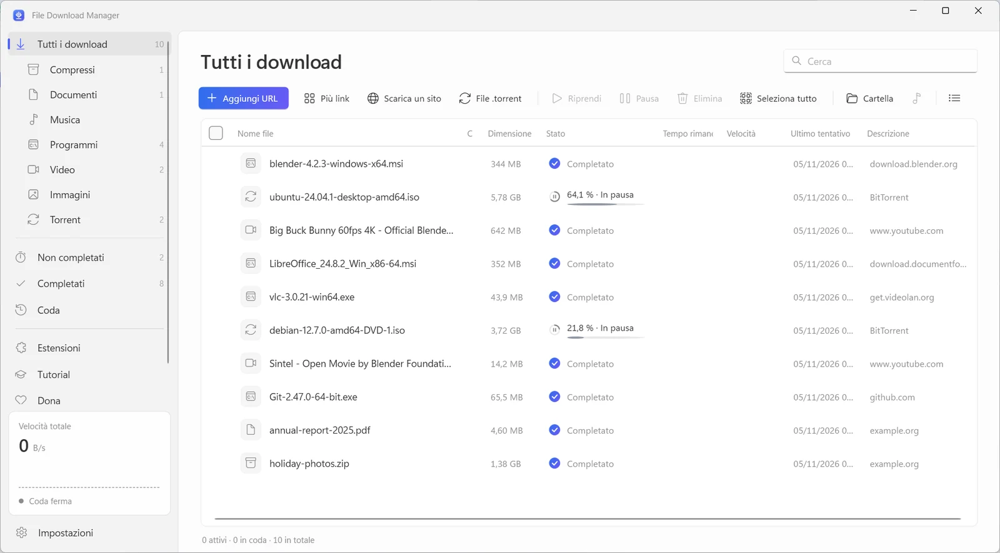
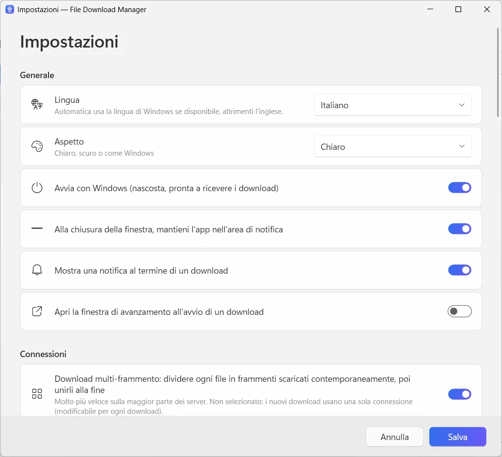

  

<h1 align="center">File Download Manager</h1>

<b>Il download manager gratuito per Windows che fa tutto</b> Gratis · Senza pubblicità · Windows 10 e 11

  
  
  

<a href="../../README.md">English</a> · <a href="README.fr.md">Français</a> · <a href="README.es.md">Español</a> · <b>Italiano</b> · <a href="README.ar.md">العربية</a> · <a href="README.ru.md">Русский</a> · <a href="README.zh.md">中文（简体）</a> · <a href="README.hi.md">हिन्दी</a> · <a href="README.ja.md">日本語</a> · <a href="README.ko.md">한국어</a> · <a href="README.de.md">Deutsch</a> · <a href="README.pt.md">Português</a> · <a href="README.he.md">עברית</a>

Accelera i download con fino a 32 connessioni per file, riprendi tutto ciò che si è interrotto, salva video da YouTube e da oltre 1.000 siti fino in 4K o in MP3 e scarica torrent, in un'unica app pulita e moderna.

**[Scarica per Windows](https://filedownloadmanager.com/it/download)** · Gratis per sempre. Nessun account, nessuna pubblicità, nessun software aggiuntivo.

## Tutto ciò che serve per scaricare più velocemente

Da un singolo file a un intero sito, File Download Manager pensa a tutto senza disturbarti.

- **Accelerazione con più connessioni** — Ogni file viene diviso in fino a 32 frammenti scaricati contemporaneamente e poi riuniti automaticamente. Ideale per immagini ISO, giochi e video di grandi dimensioni.
- **Pausa e ripresa di tutto** — Connessione persa, sospensione o riavvio: il download riprende esattamente da dove si era fermato, con nuovi tentativi automatici.
- **YouTube e oltre 1.000 siti video** — Scegli la qualità, fino al 4K a 60 fps, oppure tieni solo l'audio in MP3. Funziona con YouTube, Facebook, Vimeo, X, TikTok, Twitch e molti altri.
- **Torrent e link magnet** — Un motore BitTorrent integrato scarica file .torrent e link magnet con DHT e scambio di peer. Non serve un altro client torrent.
- **Integrato con il tuo browser** — L'estensione per Chrome, Edge, Firefox, Brave, Opera e Vivaldi intercetta i tuoi download e propone di salvare il video che stai guardando.
- **Coda e pianificatore** — Metti in fila i download, scegli quanti eseguirne insieme, avvia la coda di notte e lascia che il PC vada in sospensione o si spenga alla fine.
- **Cattura siti web** — Salva un sito intero per leggerlo offline, oppure raccogli solo le immagini, i PDF o gli archivi che collega.
- **Stream video in MP4** — Gli stream HLS (m3u8) vengono scaricati segmento per segmento e convertiti in un unico file MP4.
- **Moderno e nella tua lingua** — Un'interfaccia curata di Windows 11 con modalità scura, categorie, limitatore di velocità e 13 lingue.

## Progettato per Windows 11

Design Fluent, effetto Mica, temi chiaro e scuro: sembra parte di Windows.

| | |
|---|---|
|  |  |
| Impostazioni semplici e chiare | Tema chiaro o scuro |

## Pronto in un minuto

1. **[Installa](https://filedownloadmanager.com/it/download)** — Scarica il programma di installazione ed eseguilo. Non servono diritti di amministratore; i componenti video e torrent sono inclusi.
2. **[Aggiungi l'estensione](https://filedownloadmanager.com/it/tutorial)** — L'app ti mostra, immagine per immagine, come aggiungere l'estensione al tuo browser.
3. **Scarica** — Fai clic su un link di download o sul pulsante che appare su un video: File Download Manager subentra e va più veloce.

> Se Windows mostra «PC protetto da Windows», fai clic su **Ulteriori informazioni** e poi su **Esegui comunque**: il programma di installazione è nuovo e SmartScreen non lo conosce ancora.

**Requisiti di sistema:** Windows 10 o 11 (64 bit) · circa 500 MB liberi · connessione a Internet.

## Un'alternativa gratuita a IDM

Cerchi un'alternativa a Internet Download Manager, Free Download Manager, JDownloader o XDM? File Download Manager riunisce download con più connessioni, cattura dal browser, video e torrent, gratis e senza pubblicità.

[Confronta le funzioni →](https://filedownloadmanager.com/it/alternative)

## Domande frequenti

<b>File Download Manager è davvero gratuito?</b>

Sì. Nessun periodo di prova, nessuna chiave di licenza, nessuna pubblicità e nessun software aggiuntivo. Il progetto vive di donazioni volontarie.

<b>Quali versioni di Windows sono supportate?</b>

Windows 10 e Windows 11 a 64 bit. I componenti video, MP3 e torrent sono inclusi nell'installer e non servono diritti di amministratore.

<b>Quali browser funzionano con l'estensione?</b>

Google Chrome, Microsoft Edge, Mozilla Firefox, Brave, Opera e Vivaldi. Il tutorial illustrato mostra come aggiungerla in pochi clic.

<b>Può scaricare i video di YouTube e convertirli in MP3?</b>

Sì: YouTube e oltre 1.000 siti, scegliendo la qualità (fino al 4K se disponibile) o solo l'audio in MP3. Scarica solo i contenuti che hai il diritto di scaricare, nel rispetto del diritto d'autore e delle condizioni dei siti. I servizi protetti da DRM (Netflix, Disney+, Spotify…) non sono supportati.

<b>Posso riprendere un download che si è interrotto?</b>

Sì. Metti in pausa e riprendi quando vuoi; dopo un'interruzione o un riavvio il download continua da dove si era fermato, se il server lo consente.

<b>Scarica torrent e link magnet?</b>

Sì. Apri un file .torrent o incolla un link magnet: se ne occupa il motore BitTorrent integrato, senza installare altri programmi.

<b>È sicuro? Perché Windows mostra un avviso?</b>

Il programma di installazione è nuovo e Microsoft SmartScreen non lo conosce ancora, quindi Windows può mostrare «PC protetto da Windows»: fai clic su **Ulteriori informazioni** e poi su **Esegui comunque**. Puoi verificare il file con il checksum SHA-256 nella pagina di download. L'app si installa solo per il tuo account e si disinstalla da Impostazioni → App.

<b>In cosa è diverso da IDM?</b>

Internet Download Manager è un software a pagamento. File Download Manager è gratuito e include anche il download di video con scelta della qualità, la conversione in MP3, i torrent e un'interfaccia moderna di Windows 11 in 13 lingue.

## Ti piace File Download Manager?

È gratuito e lo resterà. Una piccola donazione aiuta a tenerlo aggiornato. **[Sostieni il progetto](https://filedownloadmanager.com/it/donate)**

## Link

- Sito ufficiale: <https://filedownloadmanager.com/it/>
- [Tutorial](https://filedownloadmanager.com/it/tutorial)
- [Privacy](https://filedownloadmanager.com/it/privacy)
- [Tutte le versioni e i checksum SHA-256: GitHub Releases](https://github.com/Oussama4422/FileDownloadManager/releases)
- [Cronologia delle versioni (in francese)](../../docs/CHANGELOG.fr.md)

---

I nomi dei prodotti citati sono marchi dei rispettivi proprietari. File Download Manager non è affiliato a essi.
