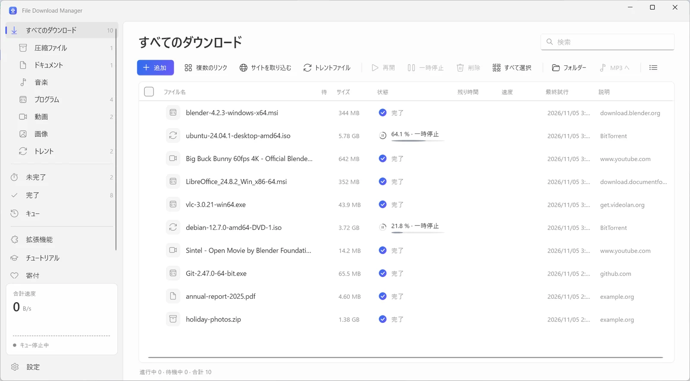
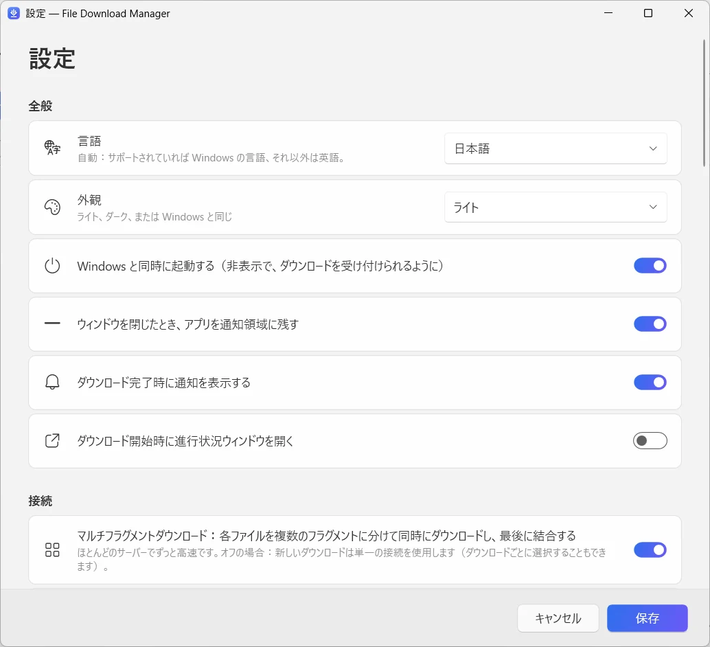

  

<h1 align="center">File Download Manager</h1>

<b>何でもこなす、Windows用の無料ダウンロードマネージャー</b> 無料 · 広告なし · Windows 10 / 11

  
  
  

<a href="../../README.md">English</a> · <a href="README.fr.md">Français</a> · <a href="README.es.md">Español</a> · <a href="README.it.md">Italiano</a> · <a href="README.ar.md">العربية</a> · <a href="README.ru.md">Русский</a> · <a href="README.zh.md">中文（简体）</a> · <a href="README.hi.md">हिन्दी</a> · <b>日本語</b> · <a href="README.ko.md">한국어</a> · <a href="README.de.md">Deutsch</a> · <a href="README.pt.md">Português</a> · <a href="README.he.md">עברית</a>

1ファイルあたり最大32接続でダウンロードを高速化し、中断したダウンロードを再開。YouTubeや1,000以上のサイトの動画を最大4KまたはMP3で保存し、トレントもダウンロード — すべてをシンプルでモダンな1つのアプリで。

**[Windows版をダウンロード](https://filedownloadmanager.com/ja/download)** · ずっと無料。アカウント不要、広告なし、余計なソフトの同梱なし。

## 速くダウンロードするためのすべて

1つのファイルからサイト丸ごとまで、File Download Manager がすべて引き受けます — 邪魔をせずに。

- **マルチ接続で高速化** — 各ファイルを最大32の断片に分けて同時にダウンロードし、自動で結合します。大きなISOイメージやゲーム、動画に最適です。
- **一時停止と再開** — 回線切断、スリープ、再起動のあとも、止まった位置から正確に再開。自動再試行にも対応します。
- **YouTube と1,000以上の動画サイト** — 画質を選択 — 最大4K・60fps — または音声だけをMP3で保存。YouTube、Facebook、Vimeo、X、TikTok、Twitch など多数のサイトに対応します。
- **トレントとマグネットリンク** — 内蔵のBitTorrentエンジンが、DHTとピア交換を使って .torrent ファイルとマグネットリンクをダウンロード。別のトレントクライアントは不要です。
- **ブラウザーと連携** — Chrome、Edge、Firefox、Brave、Opera、Vivaldi 用の拡張機能がダウンロードを引き継ぎ、視聴中の動画の保存を提案します。
- **キューとスケジューラー** — ダウンロードを並べ、同時実行数を選び、夜間にキューを開始。すべて終わったらPCをスリープまたはシャットダウンできます。
- **サイト取り込み** — サイト全体を保存してオフラインで閲覧したり、リンクされた画像・PDF・圧縮ファイルだけを集めたりできます。
- **動画ストリームをMP4に** — HLS（m3u8）ストリームをセグメントごとにダウンロードし、1つのMP4ファイルに変換します。
- **モダンで、あなたの言語で** — ダークモード、カテゴリ、速度制限、13言語に対応した洗練された Windows 11 スタイルのインターフェース。

## Windows 11 のためのデザイン

Fluent デザイン、Mica、ライト/ダークテーマ。まるで Windows の一部のようです。

| | |
|---|---|
|  |  |
| シンプルでわかりやすい設定 | ライト/ダークテーマ |

## 1分で準備完了

1. **[インストール](https://filedownloadmanager.com/ja/download)** — インストーラーをダウンロードして実行します。管理者権限は不要で、動画とトレントのコンポーネントも同梱されています。
2. **[拡張機能を追加](https://filedownloadmanager.com/ja/tutorial)** — アプリがブラウザーに拡張機能を追加する方法を画像で順番に案内します。
3. **ダウンロード** — ダウンロードリンクや動画の上に表示されるボタンをクリックするだけ。File Download Manager が引き継いで高速にダウンロードします。

> 「WindowsによってPCが保護されました」と表示されたら、**詳細情報**をクリックし、**実行**をクリックします。インストーラーが新しく、SmartScreen にまだ認識されていないためです。

**動作環境:** Windows 10 または 11（64ビット）· 約500 MBの空き容量 · インターネット接続。

## IDMの無料代替ソフト

Internet Download Manager、Free Download Manager、JDownloader、XDM、Irvine の代わりをお探しですか？File Download Manager はマルチ接続ダウンロード、ブラウザーからの取り込み、動画、トレントを1つにまとめました — 無料・広告なし。

[機能を比較する →](https://filedownloadmanager.com/ja/alternative)

## よくある質問

<b>File Download Manager は本当に無料ですか？</b>

はい。試用期間、ライセンスキー、広告、同梱ソフトは一切ありません。プロジェクトは任意の寄付で運営されています。

<b>対応している Windows のバージョンは？</b>

Windows 10 と Windows 11（64ビット）です。動画・MP3・トレントのコンポーネントはインストーラーに含まれ、管理者権限は不要です。

<b>拡張機能はどのブラウザーで使えますか？</b>

Google Chrome、Microsoft Edge、Mozilla Firefox、Brave、Opera、Vivaldi です。図解チュートリアルで数クリックの追加方法を紹介しています。

<b>YouTube の動画をダウンロードしてMP3に変換できますか？</b>

はい。YouTube と1,000以上のサイトに対応し、画質（利用可能なら最大4K）または音声のみのMP3を選べます。ダウンロードする権利のあるコンテンツだけをダウンロードし、著作権と各サイトの利用規約を守ってください。DRMで保護されたサービス（Netflix、Disney+、Spotify など）には対応していません。

<b>途中で止まったダウンロードを再開できますか？</b>

はい。いつでも一時停止・再開できます。回線切断や再起動のあとも、サーバーが対応していれば止まった位置から続きをダウンロードします。

<b>トレントやマグネットリンクもダウンロードできますか？</b>

はい。.torrent ファイルを開くか、マグネットリンクを貼り付けるだけで、内蔵のBitTorrentエンジンが処理します。ほかのソフトのインストールは不要です。

<b>安全ですか？Windows に警告が表示されるのはなぜ？</b>

インストーラーが新しく、Microsoft SmartScreen にまだ認識されていないため、「WindowsによってPCが保護されました」と表示されることがあります。**詳細情報**をクリックし、**実行**をクリックしてください。ダウンロードページの SHA-256 チェックサムでファイルを確認できます。アプリは現在のアカウントだけにインストールされ、設定 → アプリ からアンインストールできます。

<b>IDM との違いは？</b>

Internet Download Manager は有料ソフトです。File Download Manager は無料で、画質を選べる動画ダウンロード、MP3変換、トレント、13言語対応のモダンな Windows 11 インターフェースも備えています。

## File Download Manager を気に入っていただけましたか？

無料で、これからも無料です。少額の寄付が更新を続ける力になります。 **[プロジェクトを支援](https://filedownloadmanager.com/ja/donate)**

## リンク

- 公式サイト: <https://filedownloadmanager.com/ja/>
- [チュートリアル](https://filedownloadmanager.com/ja/tutorial)
- [プライバシー](https://filedownloadmanager.com/ja/privacy)
- [すべてのバージョンと SHA-256 チェックサム：GitHub Releases](https://github.com/Oussama4422/FileDownloadManager/releases)
- [バージョン履歴（フランス語）](../../docs/CHANGELOG.fr.md)

---

記載されている製品名は各所有者の商標です。File Download Manager はそれらと提携していません。
