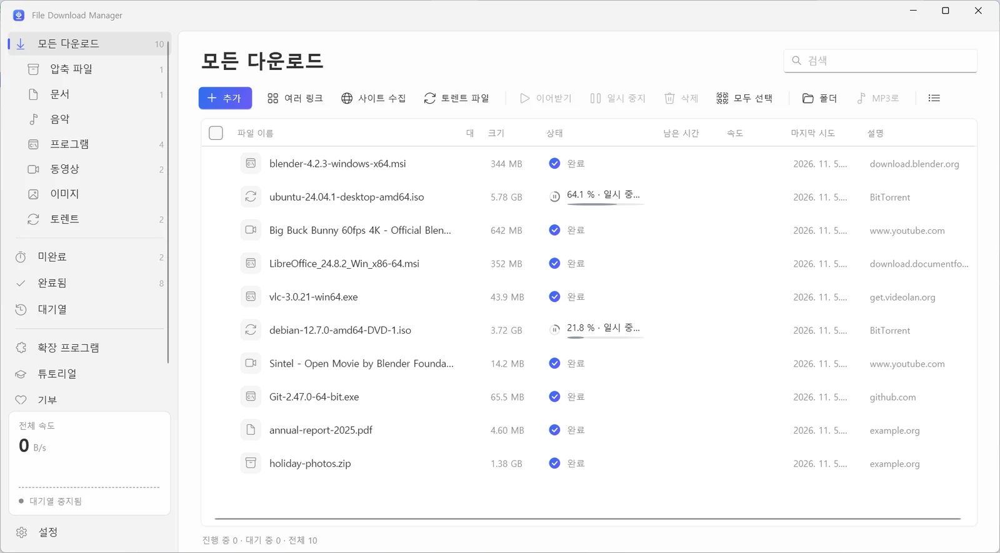
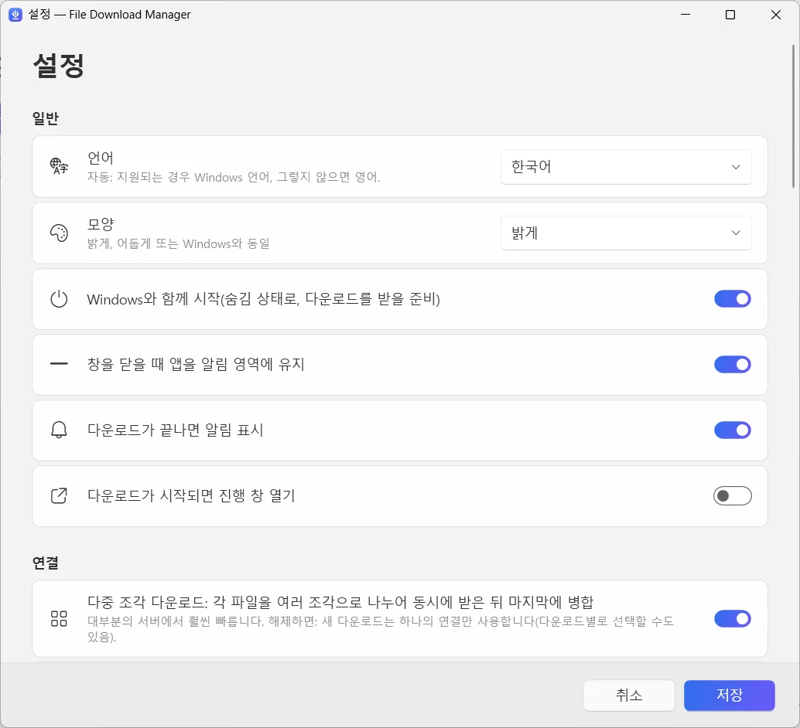

  

<h1 align="center">File Download Manager</h1>

<b>모든 것을 해내는 무료 윈도우 다운로드 매니저</b> 무료 · 광고 없음 · 윈도우 10 및 11

  
  
  

<a href="../../README.md">English</a> · <a href="README.fr.md">Français</a> · <a href="README.es.md">Español</a> · <a href="README.it.md">Italiano</a> · <a href="README.ar.md">العربية</a> · <a href="README.ru.md">Русский</a> · <a href="README.zh.md">中文（简体）</a> · <a href="README.hi.md">हिन्दी</a> · <a href="README.ja.md">日本語</a> · <b>한국어</b> · <a href="README.de.md">Deutsch</a> · <a href="README.pt.md">Português</a> · <a href="README.he.md">עברית</a>

파일당 최대 32개 연결로 다운로드 속도를 높이고, 끊긴 다운로드는 이어받고, 유튜브와 1,000개 이상의 사이트에서 최대 4K 동영상이나 MP3를 저장하고, 토렌트까지 — 깔끔하고 현대적인 하나의 앱에서.

**[윈도우용 다운로드](https://filedownloadmanager.com/ko/download)** · 영원히 무료. 가입도, 광고도, 끼워 넣은 프로그램도 없습니다.

## 더 빠른 다운로드에 필요한 모든 것

파일 하나부터 웹사이트 전체까지, File Download Manager가 방해 없이 모두 처리합니다.

- **다중 연결 가속** — 각 파일을 최대 32개 조각으로 나눠 동시에 받은 뒤 자동으로 합칩니다. 큰 ISO 이미지, 게임, 동영상에 안성맞춤입니다.
- **언제든 일시 중지와 이어받기** — 연결이 끊기거나 절전, 재시작이 되어도 멈춘 지점부터 정확히 이어서 받고, 자동으로 다시 시도합니다.
- **유튜브와 1,000개 이상의 동영상 사이트** — 화질을 선택하거나 — 최대 4K 60fps — 소리만 MP3로 저장하세요. 유튜브, 페이스북, Vimeo, X, 틱톡, 트위치 등 수많은 사이트를 지원합니다.
- **토렌트와 마그넷 링크** — 내장 BitTorrent 엔진이 DHT와 피어 교환으로 .torrent 파일과 마그넷 링크를 받습니다. 별도의 토렌트 프로그램이 필요 없습니다.
- **브라우저와 함께 작동** — Chrome, Edge, Firefox, Brave, Opera, Vivaldi용 확장 프로그램이 다운로드를 가져오고 보고 있는 동영상의 저장을 제안합니다.
- **대기열과 예약** — 다운로드를 대기열에 넣고, 동시에 받을 개수를 정하고, 밤에 대기열을 시작한 뒤 모두 끝나면 PC를 절전 또는 종료할 수 있습니다.
- **웹사이트 수집기** — 웹사이트 전체를 저장해 오프라인으로 보거나, 연결된 이미지, PDF, 압축 파일만 모을 수 있습니다.
- **동영상 스트림을 MP4로** — HLS(m3u8) 스트림을 세그먼트 단위로 받아 하나의 MP4 파일로 변환합니다.
- **현대적이고 내 언어로** — 다크 모드, 범주, 속도 제한, 13개 언어를 지원하는 깔끔한 윈도우 11 스타일 인터페이스.

## 윈도우 11을 위해 디자인

Fluent 디자인, Mica 효과, 밝은 테마와 어두운 테마: 윈도우의 일부처럼 느껴집니다.

| | |
|---|---|
|  |  |
| 간단하고 명확한 설정 | 밝은 테마 또는 어두운 테마 |

## 1분이면 준비 완료

1. **[설치](https://filedownloadmanager.com/ko/download)** — 설치 프로그램을 받아 실행하세요. 관리자 권한이 필요 없으며 동영상과 토렌트 구성 요소가 포함되어 있습니다.
2. **[확장 프로그램 추가](https://filedownloadmanager.com/ko/tutorial)** — 앱이 브라우저에 확장 프로그램을 추가하는 방법을 그림으로 하나하나 보여 줍니다.
3. **다운로드** — 다운로드 링크나 동영상 위에 나타나는 버튼을 클릭하세요. File Download Manager가 이어받아 더 빠르게 받습니다.

> “Windows의 PC 보호” 창이 나타나면 **추가 정보**를 클릭한 다음 **실행**을 클릭하세요. 설치 프로그램이 새로워 SmartScreen이 아직 인식하지 못합니다.

**시스템 요구 사항:** 윈도우 10 또는 11 (64비트) · 약 500MB의 여유 공간 · 인터넷 연결.

## IDM의 무료 대체 프로그램

Internet Download Manager, Free Download Manager, JDownloader, XDM을 대체할 프로그램을 찾으세요? File Download Manager는 다중 연결 다운로드, 브라우저 연동, 동영상, 토렌트를 한곳에 모았습니다 — 무료, 광고 없음.

[기능 비교하기 →](https://filedownloadmanager.com/ko/alternative)

## 자주 묻는 질문

<b>File Download Manager는 정말 무료인가요?</b>

네. 체험 기간, 라이선스 키, 광고, 끼워 넣은 프로그램이 전혀 없습니다. 프로젝트는 자발적인 후원으로 운영됩니다.

<b>어떤 윈도우 버전을 지원하나요?</b>

64비트 윈도우 10과 윈도우 11입니다. 동영상, MP3, 토렌트 구성 요소가 설치 프로그램에 포함되어 있으며 관리자 권한이 필요 없습니다.

<b>확장 프로그램은 어떤 브라우저에서 작동하나요?</b>

Google Chrome, Microsoft Edge, Mozilla Firefox, Brave, Opera, Vivaldi입니다. 그림 튜토리얼에서 몇 번의 클릭으로 추가하는 방법을 보여 줍니다.

<b>유튜브 동영상을 받고 MP3로 변환할 수 있나요?</b>

네. 유튜브와 1,000개 이상의 사이트에서 화질(가능하면 최대 4K)을 선택하거나 소리만 MP3로 받을 수 있습니다. 다운로드할 권리가 있는 콘텐츠만 받고, 저작권과 사이트 이용 약관을 지켜 주세요. DRM으로 보호되는 서비스(Netflix, Disney+, Spotify 등)는 지원하지 않습니다.

<b>중단된 다운로드를 이어받을 수 있나요?</b>

네. 언제든 일시 중지하고 다시 시작할 수 있습니다. 연결이 끊기거나 재시작한 뒤에도 서버가 허용하면 멈춘 지점부터 이어서 받습니다.

<b>토렌트와 마그넷 링크도 받을 수 있나요?</b>

네. .torrent 파일을 열거나 마그넷 링크를 붙여 넣으면 내장 BitTorrent 엔진이 처리합니다. 다른 프로그램을 설치할 필요가 없습니다.

<b>안전한가요? 윈도우에 경고가 뜨는 이유는?</b>

설치 프로그램이 새로워 Microsoft SmartScreen이 아직 인식하지 못하기 때문에 “Windows의 PC 보호” 창이 나타날 수 있습니다. **추가 정보**를 클릭한 다음 **실행**을 클릭하세요. 다운로드 페이지의 SHA-256 체크섬으로 파일을 확인할 수 있습니다. 앱은 현재 계정에만 설치되며 설정 → 앱에서 제거할 수 있습니다.

<b>IDM과 무엇이 다른가요?</b>

Internet Download Manager는 유료 프로그램입니다. File Download Manager는 무료이며 화질을 고르는 동영상 다운로드, MP3 변환, 토렌트, 13개 언어를 지원하는 현대적인 윈도우 11 인터페이스까지 제공합니다.

## File Download Manager가 마음에 드시나요?

무료이며 앞으로도 무료입니다. 작은 후원이 꾸준한 업데이트에 큰 힘이 됩니다. **[프로젝트 후원하기](https://filedownloadmanager.com/ko/donate)**

## 링크

- 공식 웹사이트: <https://filedownloadmanager.com/ko/>
- [튜토리얼](https://filedownloadmanager.com/ko/tutorial)
- [개인정보 보호](https://filedownloadmanager.com/ko/privacy)
- [모든 버전과 SHA-256 체크섬: GitHub Releases](https://github.com/Oussama4422/FileDownloadManager/releases)
- [버전 기록(프랑스어)](../../docs/CHANGELOG.fr.md)

---

언급된 모든 제품 이름은 각 소유자의 상표입니다. File Download Manager는 이들과 제휴 관계가 아닙니다.
