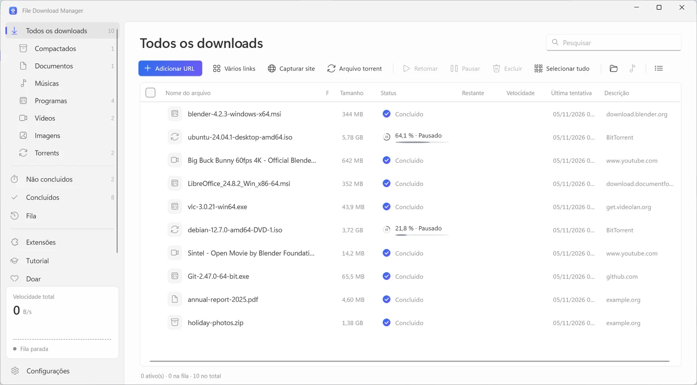
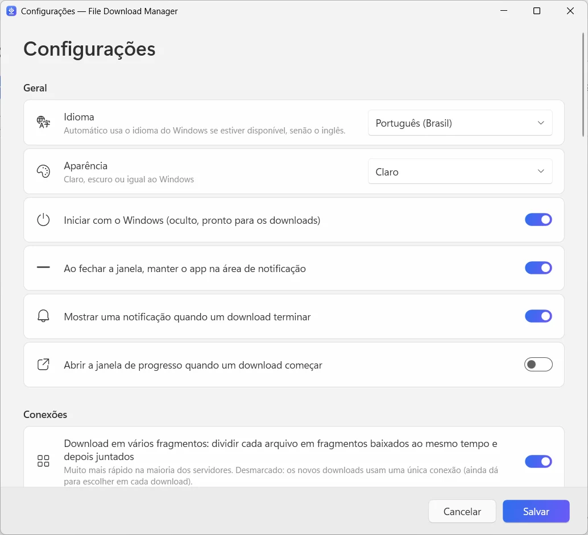

  

<h1 align="center">File Download Manager</h1>

<b>O gerenciador de downloads grátis para Windows que faz de tudo</b> Grátis · Sem anúncios · Windows 10 e 11

  
  
  

<a href="../../README.md">English</a> · <a href="README.fr.md">Français</a> · <a href="README.es.md">Español</a> · <a href="README.it.md">Italiano</a> · <a href="README.ar.md">العربية</a> · <a href="README.ru.md">Русский</a> · <a href="README.zh.md">中文（简体）</a> · <a href="README.hi.md">हिन्दी</a> · <a href="README.ja.md">日本語</a> · <a href="README.ko.md">한국어</a> · <a href="README.de.md">Deutsch</a> · <b>Português</b>

Acelere os downloads com até 32 conexões por arquivo, retome tudo o que foi interrompido, salve vídeos do YouTube e de mais de 1.000 sites em até 4K ou em MP3 e baixe torrents — em um só app, limpo e moderno.

**[Baixar para Windows](https://filedownloadmanager.com/pt/download)** · Grátis para sempre. Sem conta, sem anúncios, sem programas extras.

## Tudo o que você precisa para baixar mais rápido

De um único arquivo a um site inteiro, o File Download Manager dá conta — sem atrapalhar você.

- **Aceleração com várias conexões** — Cada arquivo é dividido em até 32 fragmentos baixados ao mesmo tempo e depois juntados automaticamente. Ideal para imagens ISO grandes, jogos e vídeos.
- **Pause e retome qualquer download** — Conexão perdida, suspensão ou reinício: o download continua exatamente de onde parou, com novas tentativas automáticas.
- **YouTube e mais de 1.000 sites de vídeo** — Escolha a qualidade — até 4K a 60 fps — ou guarde só o áudio em MP3. Funciona com YouTube, Facebook, Vimeo, X, TikTok, Twitch e muitos outros.
- **Torrents e links magnet** — Um motor BitTorrent integrado baixa arquivos .torrent e links magnet com DHT e troca de peers. Não precisa de outro cliente de torrent.
- **Funciona com o seu navegador** — A extensão para Chrome, Edge, Firefox, Brave, Opera e Vivaldi captura seus downloads e oferece salvar o vídeo que você está assistindo.
- **Fila e agendador** — Coloque downloads na fila, escolha quantos rodam ao mesmo tempo, inicie a fila à noite e deixe o PC suspender ou desligar quando tudo terminar.
- **Capturador de sites** — Salve um site inteiro para ler offline, ou junte só as imagens, PDFs ou arquivos compactados para os quais ele aponta.
- **Streams de vídeo em MP4** — Os streams HLS (m3u8) são baixados segmento por segmento e convertidos em um único arquivo MP4.
- **Moderno e no seu idioma** — Uma interface limpa do Windows 11 com modo escuro, categorias, limitador de velocidade e 12 idiomas.

## Feito para o Windows 11

Fluent Design, Mica, temas claro e escuro: parece parte do Windows.

| | |
|---|---|
|  |  |
| Configurações simples e claras | Tema claro ou escuro |

## Pronto em um minuto

1. **[Instale](https://filedownloadmanager.com/pt/download)** — Baixe o instalador e execute. Não precisa de direitos de administrador; os componentes de vídeo e torrent estão incluídos.
2. **[Adicione a extensão](https://filedownloadmanager.com/pt/tutorial)** — O app mostra, imagem por imagem, como adicionar a extensão ao seu navegador.
3. **Baixe** — Clique em um link de download ou no botão que aparece sobre um vídeo: o File Download Manager assume e baixa mais rápido.

> Se o Windows mostrar “O Windows protegeu o computador”, clique em **Mais informações** e depois em **Executar assim mesmo**: o instalador é novo e ainda não é conhecido pelo SmartScreen.

**Requisitos do sistema:** Windows 10 ou 11 (64 bits) · cerca de 500 MB de espaço livre · conexão com a internet.

## Uma alternativa grátis ao IDM

Procurando uma alternativa ao Internet Download Manager, Free Download Manager, JDownloader ou XDM? O File Download Manager reúne downloads com várias conexões, captura pelo navegador, download de vídeos e torrents — grátis e sem anúncios.

[Comparar os recursos →](https://filedownloadmanager.com/pt/alternative)

## Perguntas frequentes

<b>O File Download Manager é mesmo grátis?</b>

Sim. Não há período de teste, chave de licença, anúncios nem programas extras. O projeto vive de doações voluntárias.

<b>Quais versões do Windows são compatíveis?</b>

Windows 10 e Windows 11, 64 bits. Os componentes de vídeo, MP3 e torrent vêm no instalador, e não é preciso ter direitos de administrador.

<b>Com quais navegadores a extensão funciona?</b>

Google Chrome, Microsoft Edge, Mozilla Firefox, Brave, Opera e Vivaldi. O tutorial ilustrado mostra como adicioná-la em poucos cliques.

<b>Ele baixa vídeos do YouTube e converte para MP3?</b>

Sim: YouTube e mais de 1.000 sites, com escolha da qualidade (até 4K quando disponível) ou só o áudio em MP3. Baixe apenas conteúdos que você tem o direito de baixar e respeite os direitos autorais e os termos de uso dos sites. Serviços protegidos por DRM (Netflix, Disney+, Spotify…) não são compatíveis.

<b>Posso retomar um download que parou?</b>

Sim. Pause e retome quando quiser; depois de uma queda de conexão ou de reiniciar o PC, o download continua de onde parou, desde que o servidor permita.

<b>Ele baixa torrents e links magnet?</b>

Sim. Abra um arquivo .torrent ou cole um link magnet: o motor BitTorrent integrado cuida disso, sem outro programa para instalar.

<b>É seguro? Por que o Windows mostra um aviso?</b>

O instalador é novo e ainda não é conhecido pelo Microsoft SmartScreen, então o Windows pode mostrar “O Windows protegeu o computador”: clique em **Mais informações** e depois em **Executar assim mesmo**. Você pode verificar o arquivo com a soma SHA-256 na página de download. O app é instalado só para a sua conta e pode ser removido em Configurações → Aplicativos.

<b>Qual é a diferença para o IDM?</b>

O Internet Download Manager é um programa pago. O File Download Manager é grátis e também traz download de vídeos com escolha de qualidade, conversão para MP3, torrents e uma interface moderna do Windows 11 em 12 idiomas.

## Está gostando do File Download Manager?

Ele é grátis e vai continuar grátis. Uma pequena doação ajuda a mantê-lo atualizado. **[Apoiar o projeto](https://filedownloadmanager.com/pt/donate)**

## Links

- Site oficial: <https://filedownloadmanager.com/pt/>
- [Tutorial](https://filedownloadmanager.com/pt/tutorial)
- [Privacidade](https://filedownloadmanager.com/pt/privacy)
- [Todas as versões e somas SHA-256: GitHub Releases](https://github.com/Oussama4422/FileDownloadManager/releases)
- [Histórico de versões (em francês)](../../docs/CHANGELOG.fr.md)

---

Todos os nomes de produtos citados são marcas de seus respectivos donos. O File Download Manager não tem vínculo com eles.
