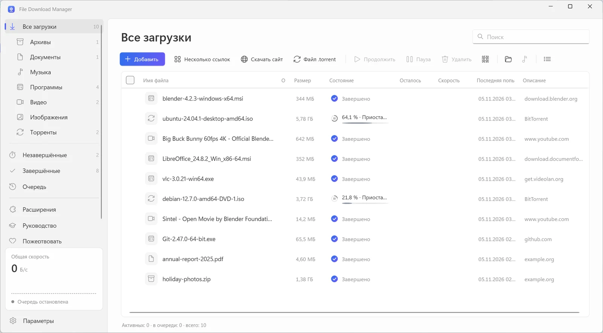
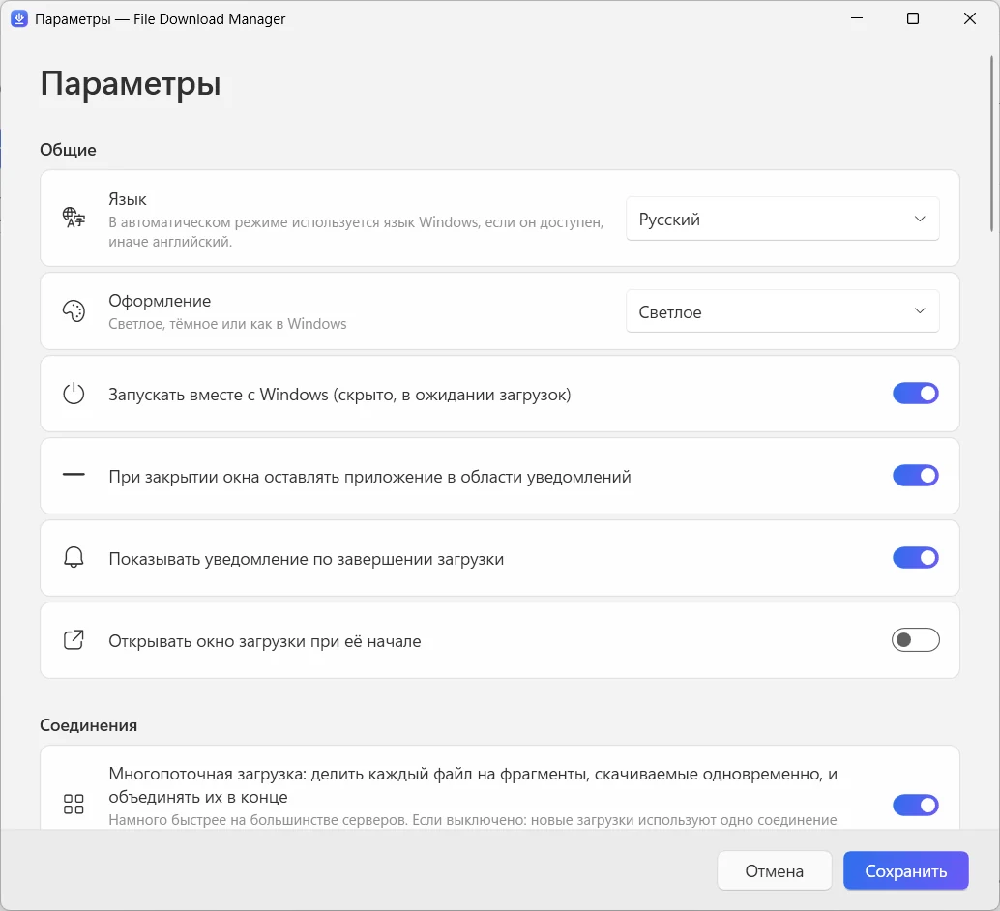

  

<h1 align="center">File Download Manager</h1>

<b>Бесплатный менеджер загрузок для Windows, который умеет всё</b> Бесплатно · Без рекламы · Windows 10 и 11

  
  
  

<a href="../../README.md">English</a> · <a href="README.fr.md">Français</a> · <a href="README.es.md">Español</a> · <a href="README.it.md">Italiano</a> · <a href="README.ar.md">العربية</a> · <b>Русский</b> · <a href="README.zh.md">中文（简体）</a> · <a href="README.hi.md">हिन्दी</a> · <a href="README.ja.md">日本語</a> · <a href="README.ko.md">한국어</a> · <a href="README.de.md">Deutsch</a> · <a href="README.pt.md">Português</a>

Ускоряйте загрузки до 32 потоков на файл, докачивайте всё прерванное, сохраняйте видео с YouTube и более 1000 сайтов в качестве до 4K или в MP3 и качайте торренты — в одном аккуратном и современном приложении.

**[Скачать для Windows](https://filedownloadmanager.com/ru/download)** · Бесплатно навсегда. Без регистрации, рекламы и дополнительных программ.

## Всё, чтобы скачивать быстрее

От одного файла до целого сайта — File Download Manager справится со всем и не будет мешать.

- **Многопоточное ускорение** — Каждый файл делится на 32 фрагмента, которые загружаются одновременно и автоматически собираются. Идеально для ISO-образов, игр и больших видео.
- **Пауза и докачка** — Обрыв связи, сон или перезагрузка — загрузка продолжится ровно с того места, где остановилась, с автоматическими повторами.
- **YouTube и более 1000 видеосайтов** — Выбирайте качество — до 4K при 60 кадрах/с — или сохраняйте только звук в MP3. Работает с YouTube, Facebook, Vimeo, X, TikTok, Twitch и многими другими.
- **Торренты и magnet-ссылки** — Встроенный движок BitTorrent загружает .torrent-файлы и magnet-ссылки с DHT и обменом пирами. Отдельный торрент-клиент не нужен.
- **Работает с вашим браузером** — Расширение для Chrome, Edge, Firefox, Brave, Opera и Vivaldi перехватывает загрузки и предлагает сохранить видео, которое вы смотрите.
- **Очередь и планировщик** — Ставьте загрузки в очередь, выбирайте, сколько качать одновременно, запускайте очередь ночью — ПК уснёт или выключится, когда всё будет готово.
- **Загрузка сайтов** — Сохраните сайт целиком для чтения офлайн или соберите только картинки, PDF и архивы, на которые он ссылается.
- **Видеопотоки в MP4** — Потоки HLS (m3u8) скачиваются по сегментам и собираются в один файл MP4.
- **Современный и на вашем языке** — Аккуратный интерфейс в стиле Windows 11: тёмная тема, категории, ограничение скорости и 12 языков.

## Создан для Windows 11

Fluent Design, эффект Mica, светлая и тёмная темы — как будто часть Windows.

| | |
|---|---|
|  |  |
| Простые и понятные настройки | Светлая или тёмная тема |

## Готово за минуту

1. **[Установите](https://filedownloadmanager.com/ru/download)** — Скачайте установщик и запустите его. Права администратора не нужны; компоненты для видео и торрентов уже включены.
2. **[Добавьте расширение](https://filedownloadmanager.com/ru/tutorial)** — Приложение покажет в картинках, как добавить расширение в ваш браузер.
3. **Скачивайте** — Нажмите на ссылку загрузки или на кнопку, появившуюся над видео: File Download Manager перехватит загрузку и скачает быстрее.

> Если Windows покажет «Система Windows защитила ваш компьютер», нажмите **Подробнее**, затем **Выполнить в любом случае**: установщик новый и ещё неизвестен SmartScreen.

**Системные требования:** Windows 10 или 11 (64 бит) · около 500 МБ свободного места · подключение к интернету.

## Бесплатный аналог IDM

Ищете замену Internet Download Manager, Free Download Manager, JDownloader, XDM или Download Master? File Download Manager объединяет многопоточную загрузку, перехват из браузера, видео и торренты — бесплатно и без рекламы.

[Сравнить возможности →](https://filedownloadmanager.com/ru/alternative)

## Частые вопросы

<b>File Download Manager действительно бесплатный?</b>

Да. Никакого пробного периода, лицензионного ключа, рекламы и дополнительных программ. Проект живёт на добровольные пожертвования.

<b>Какие версии Windows поддерживаются?</b>

Windows 10 и Windows 11, 64 бит. Компоненты для видео, MP3 и торрентов входят в установщик, права администратора не нужны.

<b>С какими браузерами работает расширение?</b>

Google Chrome, Microsoft Edge, Mozilla Firefox, Brave, Opera и Vivaldi. Инструкция с картинками показывает, как добавить его в пару щелчков.

<b>Можно ли скачивать видео с YouTube и конвертировать в MP3?</b>

Да: YouTube и более 1000 сайтов, с выбором качества (до 4K, если доступно) или только звука в MP3. Скачивайте только то, на что у вас есть права, соблюдая авторское право и условия сайтов. Сервисы с DRM (Netflix, Disney+, Spotify…) не поддерживаются.

<b>Можно ли докачать прерванную загрузку?</b>

Да. Ставьте на паузу и продолжайте когда угодно; после обрыва или перезагрузки загрузка продолжится с места остановки, если сервер это позволяет.

<b>Скачивает ли он торренты и magnet-ссылки?</b>

Да. Откройте .torrent-файл или вставьте magnet-ссылку — встроенный движок BitTorrent всё сделает, ничего дополнительно устанавливать не нужно.

<b>Это безопасно? Почему Windows показывает предупреждение?</b>

Установщик новый и пока неизвестен Microsoft SmartScreen, поэтому Windows может показать «Система Windows защитила ваш компьютер»: нажмите **Подробнее**, затем **Выполнить в любом случае**. Файл можно проверить по контрольной сумме SHA-256 на странице загрузки. Приложение ставится только для вашей учётной записи и удаляется через Параметры → Приложения.

<b>Чем он отличается от IDM?</b>

Internet Download Manager — платная программа. File Download Manager бесплатен и вдобавок умеет скачивать видео с выбором качества, конвертировать в MP3, качать торренты и имеет современный интерфейс Windows 11 на 12 языках.

## Нравится File Download Manager?

Он бесплатный и таким останется. Небольшое пожертвование помогает выпускать обновления. **[Поддержать проект](https://filedownloadmanager.com/ru/donate)**

## Ссылки

- Официальный сайт: <https://filedownloadmanager.com/ru/>
- [Инструкция](https://filedownloadmanager.com/ru/tutorial)
- [Конфиденциальность](https://filedownloadmanager.com/ru/privacy)
- [Все версии и контрольные суммы SHA-256: GitHub Releases](https://github.com/Oussama4422/FileDownloadManager/releases)
- [История версий (на французском)](../../docs/CHANGELOG.fr.md)

---

Упомянутые названия продуктов являются товарными знаками их владельцев. File Download Manager не связан с ними.
