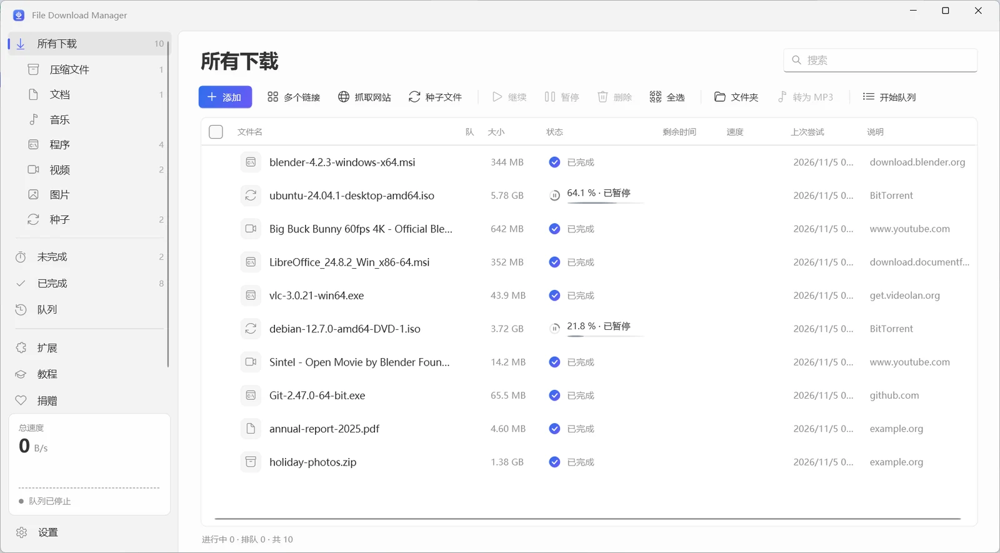
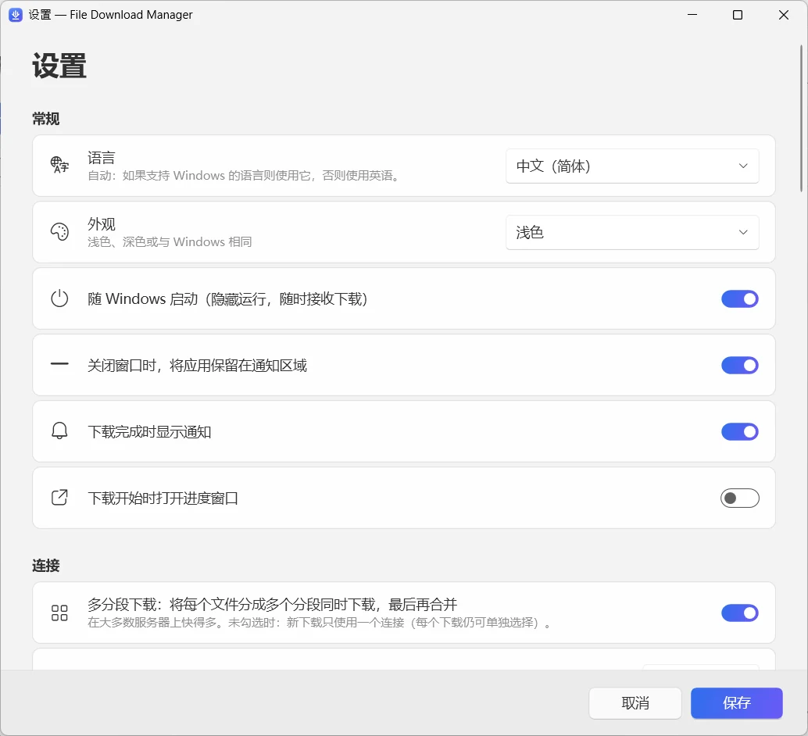

  

<h1 align="center">File Download Manager</h1>

<b>功能全面的免费 Windows 下载管理器</b> 免费 · 无广告 · Windows 10 和 11

  
  
  

<a href="../../README.md">English</a> · <a href="README.fr.md">Français</a> · <a href="README.es.md">Español</a> · <a href="README.it.md">Italiano</a> · <a href="README.ar.md">العربية</a> · <a href="README.ru.md">Русский</a> · <b>中文（简体）</b> · <a href="README.hi.md">हिन्दी</a> · <a href="README.ja.md">日本語</a> · <a href="README.ko.md">한국어</a> · <a href="README.de.md">Deutsch</a> · <a href="README.pt.md">Português</a> · <a href="README.he.md">עברית</a>

每个文件最多 32 个连接同时下载，中断的任务随时续传，从 YouTube 和 1000 多个网站保存最高 4K 的视频或 MP3 音频，还能下载 BT 种子——全部集中在一个简洁现代的应用中。

**[下载 Windows 版](https://filedownloadmanager.com/zh/download)** · 永久免费。无需帐户，没有广告，不捆绑其他软件。

## 更快下载所需的一切

从单个文件到整个网站，File Download Manager 都能轻松搞定，而且从不打扰你。

- **多线程加速** — 每个文件被分成最多 32 个分段同时下载，完成后自动合并。非常适合 ISO 镜像、游戏和大型视频。
- **随时暂停与续传** — 断网、睡眠或重启后，下载会从中断的位置继续，并自动重试。
- **YouTube 及 1000 多个视频网站** — 自由选择画质——最高 4K 60 帧——或只保留 MP3 音频。支持 YouTube、Facebook、Vimeo、X、TikTok、Twitch 等众多网站。
- **BT 种子和磁力链接** — 内置 BitTorrent 引擎，支持 DHT 和节点交换，可直接下载 .torrent 文件和磁力链接，无需另装 BT 客户端。
- **与浏览器无缝配合** — 适用于 Chrome、Edge、Firefox、Brave、Opera 和 Vivaldi 的扩展会接管你的下载，并提示保存正在观看的视频。
- **队列与计划任务** — 将下载加入队列，设置同时下载的数量，在夜间自动开始，全部完成后让电脑睡眠或关机。
- **网站抓取** — 保存整个网站以便离线浏览，或只收集其中链接的图片、PDF 或压缩文件。
- **视频流转 MP4** — HLS（m3u8）视频流按片段下载，并转换为单个 MP4 文件。
- **现代界面，支持你的语言** — 精致的 Windows 11 风格界面，支持深色模式、分类、限速和 13 种语言。

## 为 Windows 11 而设计

Fluent 设计、Mica 材质、浅色与深色主题：就像 Windows 自带的一样。

| | |
|---|---|
|  |  |
| 简洁清晰的设置 | 浅色或深色主题 |

## 一分钟即可就绪

1. **[安装](https://filedownloadmanager.com/zh/download)** — 下载并运行安装程序。无需管理员权限，视频和 BT 组件均已内置。
2. **[添加扩展](https://filedownloadmanager.com/zh/tutorial)** — 应用会通过图片一步步告诉你如何把扩展添加到浏览器。
3. **开始下载** — 点击下载链接或视频上出现的按钮：File Download Manager 会接管下载，速度更快。

> 如果 Windows 显示“Windows 已保护你的电脑”，请点击**更多信息**，再点击**仍要运行**：安装程序是新发布的，SmartScreen 尚未识别。

**系统要求:** Windows 10 或 11（64 位）· 约 500 MB 可用空间 · 互联网连接。

## IDM 的免费替代品

在寻找 Internet Download Manager、Free Download Manager、JDownloader、XDM 或迅雷的替代品？File Download Manager 集多线程下载、浏览器接管、视频下载和 BT 下载于一身——免费且无广告。

[比较功能 →](https://filedownloadmanager.com/zh/alternative)

## 常见问题

<b>File Download Manager 真的免费吗？</b>

是的。没有试用期，没有许可证密钥，没有广告，也不捆绑任何软件。项目依靠自愿捐赠维持。

<b>支持哪些 Windows 版本？</b>

64 位的 Windows 10 和 Windows 11。视频、MP3 和 BT 组件已包含在安装程序中，且无需管理员权限。

<b>扩展支持哪些浏览器？</b>

Google Chrome、Microsoft Edge、Mozilla Firefox、Brave、Opera 和 Vivaldi。图文教程演示了如何用几次点击完成添加。

<b>能下载 YouTube 视频并转换为 MP3 吗？</b>

可以：支持 YouTube 和 1000 多个网站，可选择画质（如有，最高 4K）或只下载 MP3 音频。请只下载你有权下载的内容，并遵守版权法和网站的使用条款。受 DRM 保护的服务（Netflix、Disney+、Spotify 等）不受支持。

<b>中断的下载可以继续吗？</b>

可以。随时暂停和继续；断网或重启后，只要服务器支持，下载会从中断处继续。

<b>能下载 BT 种子和磁力链接吗？</b>

可以。打开 .torrent 文件或粘贴磁力链接，内置的 BitTorrent 引擎就会处理，无需安装其他软件。

<b>安全吗？为什么 Windows 会显示警告？</b>

安装程序是新发布的，Microsoft SmartScreen 尚未识别，因此 Windows 可能显示“Windows 已保护你的电脑”：请点击**更多信息**，再点击**仍要运行**。你可以在下载页面用 SHA-256 校验值核对文件。应用只为当前帐户安装，可在“设置 → 应用”中卸载。

<b>它和 IDM 有什么不同？</b>

Internet Download Manager 是付费软件。File Download Manager 免费，并额外提供可选画质的视频下载、MP3 转换、BT 下载，以及支持 13 种语言的现代 Windows 11 界面。

## 喜欢 File Download Manager 吗？

它是免费的，并将一直免费。一笔小小的捐赠就能帮助它持续更新。 **[支持本项目](https://filedownloadmanager.com/zh/donate)**

## 链接

- 官方网站: <https://filedownloadmanager.com/zh/>
- [教程](https://filedownloadmanager.com/zh/tutorial)
- [隐私](https://filedownloadmanager.com/zh/privacy)
- [所有版本及 SHA-256 校验值：GitHub Releases](https://github.com/Oussama4422/FileDownloadManager/releases)
- [版本历史（法语）](../../docs/CHANGELOG.fr.md)

---

文中提及的产品名称均为其各自所有者的商标。File Download Manager 与其无关联。
